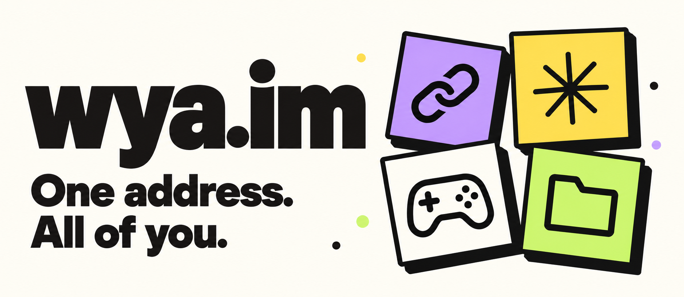

# wya.im

*Where you at?*

A personal page for your links, your work, and whatever else you're into. Give it a username, add your stuff, and share one address.

```text
wya.im/alex
wya.im/alex/github
wya.im/alex?tab=games
```

You can edit everything in the dashboard, or connect it to ChatGPT and ask:

> “Add my GitHub to my personal space.”
>
> “Move my portfolio above my socials.”
>
> “Create a Games tab with a Favorite Game section.”

## Make it yours

Add a picture, pick a color, write a bio. Keep your page as a simple list, or split it into tabs and sections. Projects get room for a description, thumbnail, and links to things like a demo or source code.

- Five separate spaces per account, each with its own username.
- Short links with editable names, custom icons, and extra aliases.
- Social presets and email links.
- Showcase a single Game or build a Game Collection with up to 20 catalog picks, a cover grid, and optional links for each game. Group existing games without breaking their short URLs.
- Up to five tabs per space, with shareable addresses. Export a tab as JSON or import it into another space, with a preview of conflicting URLs.
- Drag-and-drop ordering that waits until you hit **Save layout**.
- Content history, so you can bring back an earlier version.

Sign in with an email code. No password to remember.

## Use it with ChatGPT

Edits to existing entries save automatically. New entries use Add, and page layout changes use Save layout.

Connect `https://wya.im/mcp` using OAuth, sign in, and choose the space you want to work on. The connection can read your profile and search for games and update links, projects, Games, Game Collections, tabs, and sections.

See the [connection setup](docs/deployment.md#connect-chatgpt) for details. Custom connection availability depends on your ChatGPT account or workspace.

## Run locally

You'll need Node.js 22.13+ and npm.

```sh
npm run install:ci
npm run db:migrate:local
npm run dev
```

Open `http://127.0.0.1:5173` and follow the sign-in link. Local development uses a simulated account, so you don't need email credentials to try it out.

Using VS Code? Choose **wya.im: Local development** in Run and Debug and press **F5**. It runs local migrations and opens the app for you.

Game search needs IGDB credentials; see [catalog setup](docs/deployment.md#game-catalog-igdb). The dashboard fills in titles and covers from your selection.

Local data lives in `.wrangler/state`. Run `npm run db:migrate:local` again after pulling database changes.

To check your changes:

```sh
npm test
npm run typecheck
npm run lint
npm run format:check
npm run build
```

Run `npm run format` to format the app, domain code, scripts, and tests. Generated files and upstream UI components are excluded.

## Under the hood

React and TypeScript, running through Vinext on Cloudflare Workers. D1 stores profiles and accounts; R2 stores profile pictures. Better Auth handles sign-in and OAuth, Resend delivers login codes, and Turnstile protects the sign-in flow.

The dashboard and ChatGPT tools use the same service, so edits from either place follow the same rules.

- [Architecture](docs/architecture.md) — how the app fits together.
- [Deployment](docs/deployment.md) — Cloudflare setup, secrets, migrations, and integration tests.
- [Ideas](docs/ideas.md) — things we're exploring next, including more interests, covers, and page designs.

GitHub Actions checks pull requests and can deploy `main` when `CLOUDFLARE_DEPLOY_ENABLED` is enabled. Deployment-triggering pushes and workflow runs need owner approval; see [AGENTS.md](AGENTS.md).
