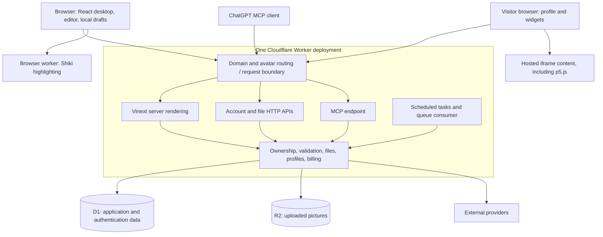
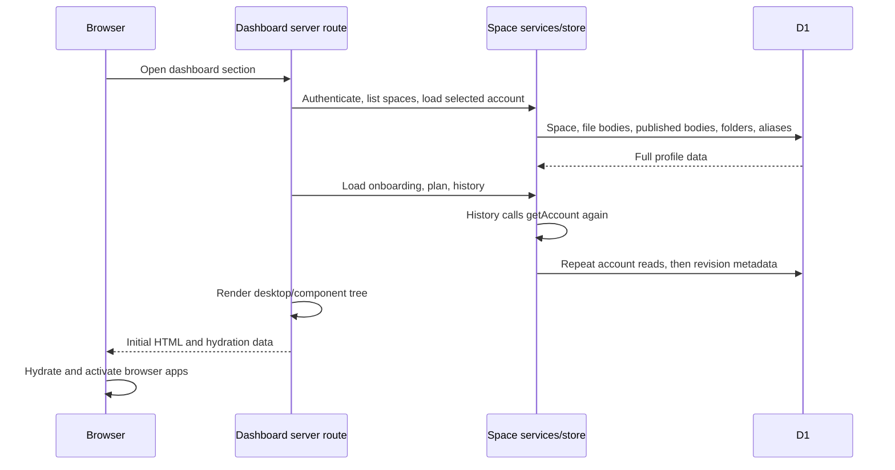
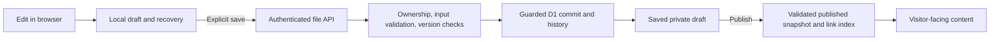

> Historical review baseline. The subsequent OS removal and current browser/server boundary are documented in [Browser dashboard architecture](dashboard-client-architecture.md) and [Architecture](architecture.md).

# wya.im architecture review

Follow-up: the user approved replacing both OS interfaces with a single-column UI. See [browser dashboard architecture](dashboard-client-architecture.md) for the local implementation, remaining limitations, and the implemented static app and pending production cutover at `app.wya.im`. The assessment below records the pre-replacement baseline.

Review date: October 29, 2026. Source baseline: `2cc536f` plus the staged editor SSR and Markdown parsing mitigations described below. This is a review of the current implementation, not a claim that every local change is deployed.

**The application needs clearer rendering and data-loading boundaries. It does not currently need a microservices rewrite.** The private dashboard and public profiles share a substantial desktop component tree; account reads load complete file contents; several paths repeat that work. Those choices make request cost grow with content that the visitor might never open.

This document proposes changes for review. It does not authorize or perform a deployment, migration, or application refactor. [Architecture](architecture.md) remains the detailed implementation reference; [deployment](deployment.md) covers operational setup.

## 1. Assessment

| Area                      | Current assessment                                                                                                                                                                                                   |
| ------------------------- | -------------------------------------------------------------------------------------------------------------------------------------------------------------------------------------------------------------------- |
| Overall structure         | A modular monolith: one Worker deployment, multiple transports, shared services and storage. Reasonable for this product and its current stage.                                                                      |
| Rendering                 | The dashboard has server-rendered initial output followed by browser hydration. Browser-only editing dependencies were entering that server render. A local mitigation now gates the editor until hydration.         |
| Reads                     | Too broad. Whole-space loads are reused for history authorization, file listings, individual-file access, public projection, and UI bootstrap.                                                                       |
| Writes                    | Useful safeguards exist: explicit file saves, optimistic versions, atomic guarded database operations, and separate draft/published snapshots. Some operations still inspect or snapshot the entire file collection. |
| Public/private separation | Authorization and published-content filtering exist. Rendering and data-access responsibilities are less clearly separated than the security boundary.                                                               |
| Production reliability    | Tests and deployment checks are substantial, but representative rendering cost and authenticated production behavior are not adequately covered by those checks.                                                     |
| Error 1102                | Confirmed resource-limit failure. Exact CPU-versus-memory cause and the responsible code path remain unconfirmed.                                                                                                    |

The first correction should be to make work proportional to the screen or operation requested. Moving everything to the browser without changing the APIs would leave much of the excessive loading intact.

## 2. What runs where

The framework uses React and Next-style application APIs through **Vinext and Vite**, deployed with the Cloudflare integration. It is not a conventional long-running Node server. The browser, Worker, D1, R2, hosted iframes, and third-party providers are separate execution environments.

The Worker entry point routes domains and avatars before handing requests to Vinext. It also exposes scheduled and queue handlers. Sharing one deployment increases the scope of a bad release; it does not prove every route consumes the same resources or fails together.

Sources: [package.json](../package.json), [Vite configuration](../vite.config.ts), [Worker entry](../deployment/worker.ts), [request boundary](../deployment/request-boundary.ts).

### Rendering responsibilities

| Surface              | Current execution                                                                                                                                                                                  | Recommended boundary                                                                                   |
| -------------------- | -------------------------------------------------------------------------------------------------------------------------------------------------------------------------------------------------- | ------------------------------------------------------------------------------------------------------ |
| Private dashboard    | Dynamic server route authenticates, loads account data, and renders the shared React desktop before hydration.                                                                                     | Lightweight authenticated shell and minimal bootstrap; interactive desktop and editing in the browser. |
| Rich Markdown editor | Before the staged fix, lazy loading still allowed the editor module and Markdown conversion/configuration work during SSR. `immediatelyRender: false` already deferred the actual editor instance. | Browser-only module initialization and editing. Keep server validation of submitted data.              |
| Public profile       | Dynamic SSR loads a profile and its published content, then renders a desktop or profile view.                                                                                                     | Retain useful initial HTML, with a dedicated read-only renderer and bounded published-data loading.    |
| Code highlighting    | UI highlighting starts from a browser effect and uses a dedicated browser worker.                                                                                                                  | Keep it off the request rendering path; maintain bounded caches and input limits.                      |
| Embedded p5.js       | Hosted sketch runs inside an iframe.                                                                                                                                                               | Keep sketch execution outside the application Worker.                                                  |
| APIs and jobs        | Authentication, authorization, validation, storage, and integration calls run in the Worker.                                                                                                       | Remain server-side. Improve their query and workload boundaries.                                       |

**`'use client'` does not mean that a component has no initial server render. `React.lazy` alone does not establish that boundary either.** Conversely, SSR does not mean every keystroke renders on the server: after hydration, browser state handles interaction. File edits are now held locally until an explicit save/publish operation.

Sources: [dashboard route](../app/dashboard/[section]/page.tsx), [workspace](../app/dashboard/workspace.tsx), [text editor](../app/components/desktop-profile/text-editor.tsx), [rich editor](../app/components/document-editor/rich-markdown-editor.tsx), [staged browser gate](../app/components/document-editor/lazy-rich-markdown-editor.tsx), [highlighting](../lib/syntax-highlighting.ts).

## 3. The expensive paths

### Opening the private dashboard

`getAccount` is not a small identity lookup. The store's `readProfile` loads files including draft and published contents, folders, and aliases. On older data, it can also trigger the Markdown migration before returning the profile. `getHistory` calls `getAccount` again before reading revision metadata.

The route awaits several reads sequentially. Some could run independently after authentication and space selection, but parallelizing them alone would not remove duplicate reads or unnecessary file bodies.

Sources: [dashboard route](../app/dashboard/[section]/page.tsx), [service facade](../lib/service.ts), [space store](../lib/space-store.ts).

### Listing or opening files

The file service reads the complete collection even for some individual-file operations. Listing then projects file metadata from objects that already contain file bodies. Public individual-file access also begins from a collection read and public filtering.

The current limits are 30 files per space and 128 KiB per file. Thirty maximum-sized draft bodies alone are approximately 3.75 MiB, before published copies, JSON objects, syntax trees, rendered markup, or history. This is an illustrative upper bound, not a measurement of the failing account.

A file listing should query metadata. Opening one file should query that file. Resolving a short link should use the compiled link index, a specialization that already exists in the redirect path.

Sources: [file service](../lib/space-file-service.ts), [file store](../lib/markdown-file-store.ts), [file limits](../lib/space-files.ts), [file API](../app/api/files/route.ts).

### Serving public content

Public filtering correctly chooses published snapshots rather than exposing drafts. However, it happens after a broad store read. Building the public projection and derived link index parses documents; the desktop and mobile-layout helpers can invoke public projection again. Later rendering/validation can add more parsing.

The public route's metadata function and page function both call `getPublicProfile`. There is no explicit shared request memoization at that boundary. Whether the framework deduplicates any underlying work must be measured rather than assumed.

Responsive rendering is another audit point: preparing both desktop and column representations can perform work for a representation the user will not see. Actual duplication depends on the selected mode and window state; not every app is rendered on every request.

Sources: [public route](../app/[handle]/page.tsx), [public profile projection](../lib/public-profile.ts), [published files](../lib/profile-files.ts), [desktop renderer](../app/components/desktop-profile/desktop-profile.tsx), [mobile layout](../lib/mobile-layout.ts).

## 4. Saving, publishing, and history

The file draft session distinguishes local edits from the last saved server version. Editing changes local state; explicit operations serialize in-flight writes and carry version information. Local recovery helps preserve unfinished work. A version conflict should remain a conflict, not silently overwrite a newer server version.

The save path still reads and clones the file collection and derives indexes. When a revision is created, `commitMarkdownFiles` snapshots the previous file collection in separate revision rows. **It does not blindly rewrite every current file:** it computes changed files for current-table updates. Nevertheless, one-file changes can generate work proportional to the space, especially history storage and derived-data processing.

Account mutations also return broad response envelopes containing profile, history, spaces, and plan. The dashboard's file refresh uses the account endpoint. Smaller responses and targeted state updates would avoid fetching an entire account to reflect a local change.

Do not conflate these paths with legacy entry autosave: explicit file saving does not imply every setting or legacy mutation across the application follows the same policy.

Sources: [draft session](../lib/file-draft-session.ts), [draft recovery](../lib/file-draft-recovery.ts), [file client](../lib/file-client.ts), [file service](../lib/space-file-service.ts), [atomic storage](../lib/markdown-file-store.ts), [workspace state](../app/dashboard/use-workspace.ts), [account endpoint](../app/api/account/route.ts).

## 5. Data ownership and persistence

| Data                                      | Current authority                                                              | Review concern                                                                                                   |
| ----------------------------------------- | ------------------------------------------------------------------------------ | ---------------------------------------------------------------------------------------------------------------- |
| User identity, sessions, OAuth            | Better Auth with database-backed state                                         | Keep authentication on the server and trusted-header handling explicit.                                          |
| Spaces and profile settings               | D1 space records                                                               | Avoid using the full profile object as the universal query/response format.                                      |
| Markdown, text, widgets, folders          | D1 file/folder records                                                         | Markdown files are canonical; `.widget` constrains a supported block rather than introducing a second renderer.  |
| Public content                            | Published file snapshots and public projection                                 | Public reads should eventually select published columns directly. Draft data should not be loaded unnecessarily. |
| History                                   | Space revisions plus per-file revision snapshots                               | Measure write amplification, retention growth, and restore cost.                                                 |
| Trash and permanent deletion              | Trash records/items and file tombstones                                        | Preserve protections against history restoring permanently deleted content.                                      |
| Pictures                                  | R2 objects with D1 metadata                                                    | Asset redirects avoid serving picture bytes through profile rendering.                                           |
| Desktop preferences and unfinished drafts | A mixture of persisted profile settings and browser-local preferences/recovery | Document each preference's scope; browser-local state is not account synchronization or a backup guarantee.      |
| Mobile/all-screen column layout           | Profile layout configuration                                                   | Keep it independent from browser-only desktop geometry.                                                          |
| Legacy tabs/sections                      | Compatibility and migration code still exists                                  | Migration is not complete architectural removal; inventory remaining readers/writers before deleting adapters.   |

The core ownership/version checks and separate published snapshots are assets to preserve. A rendering refactor must not weaken them.

Sources: [schema](../db/schema.ts), [space store](../lib/space-store.ts), [Markdown store](../lib/markdown-file-store.ts), [mobile layout model](../lib/mobile-layout.ts), [authentication entry](../app/chatgpt-auth.ts), [auth configuration](../lib/auth/config.ts).

## 6. Integrations and trust boundaries

| Integration                   | Responsibility                                | Architectural boundary                                                                                 |
| ----------------------------- | --------------------------------------------- | ------------------------------------------------------------------------------------------------------ |
| ChatGPT/MCP                   | Scoped account and content operations         | Reuses server services and authorization. It does not require an AI inference call for each operation. |
| Cloudflare custom domains     | Ownership, hostname provisioning, HTTPS state | Request routing and background reconciliation are distinct. Pending/invalid mappings must fail closed. |
| Stripe                        | Checkout, subscription management, events     | Entitlements must derive from verified server-side state, not browser claims.                          |
| Discord                       | Public community widget and feedback delivery | Feedback webhook stays server-side; email support is a separate channel.                               |
| Resend and Turnstile          | Login email and abuse checks                  | Provider failure needs a bounded, understandable failure path.                                         |
| GIPHY, IGDB, PostHog          | Media search, catalog, analytics              | Optional provider/configuration failures should not block editing or saving unrelated content.         |
| Hosted p5.js and other embeds | External interactive content                  | Execute in isolated browser frames, not inside the Worker rendering pipeline.                          |

The standalone request boundary strips untrusted identity headers. Custom-domain routing limits access to public surfaces. Private pages are marked private/no-store. These are important boundaries, but this document is not a complete security audit.

Sources: [request boundary](../deployment/request-boundary.ts), [Worker routing/jobs](../deployment/worker.ts), [MCP endpoint](../app/mcp/route.ts), [MCP handler](../lib/mcp-handler.ts), [existing integration reference](architecture.md).

## 7. Error 1102: evidence and limits

The screenshot shows a resource-limit error on `/dashboard/files` at **2026-10-29 23:20:18 UTC**, Ray ID `a525e8f8df402ea`. Cloudflare documents 1102 for CPU or memory limit violations; the error page alone does not distinguish them. [Cloudflare error documentation](https://developers.cloudflare.com/workers/observability/errors/).

The preceding investigation found two `exceededResources` events in the surrounding ten-minute aggregate. Successful live public-profile requests also showed substantial CPU time, approximately 0.6-1.2 seconds in three samples. Those samples were not the authenticated failing dashboard request. Historical per-request telemetry access was restricted, and no failing-request heap profile was captured.

Consequently:

- The resource failure is real; server-side content work is a credible area to investigate.
- We have not established whether this incident exhausted CPU or memory.
- We have not proved that rich-editor loading, Markdown parsing, or Shiki caused this incident.
- A successful local run or a large passing test suite does not establish production resource headroom.
- Traffic capacity and cost per active user cannot be responsibly estimated from these samples.

### Local mitigations already prepared

At review time, staged changes gate the rich editor until browser hydration and reuse an already parsed Markdown tree during public projection. Focused tests cover the SSR boundary and projection behavior. These changes reduce identifiable unnecessary work, but are **not a verified production fix** and were not deployed as part of this review.

The gate changes the editor boundary, not the entire dashboard's rendering model. A production follow-up needs the deployed version, request outcome, CPU measurements, and memory evidence correlated to the same request class.

## 8. Priority risks

| Priority | Finding                                                                    | Evidence level                                | Required response                                                                                    |
| -------- | -------------------------------------------------------------------------- | --------------------------------------------- | ---------------------------------------------------------------------------------------------------- |
| P0       | Production resource failure has no confirmed mechanism yet.                | Observed incident; cause unknown.             | Capture route/version/outcome diagnostics and reproduce with representative content.                 |
| P0       | Browser-only editor work entered SSR.                                      | Confirmed code path; staged mitigation.       | Verify the boundary in the release build and then production after separately approved deployment.   |
| P1       | Metadata and individual-file operations load whole collections.            | Confirmed source behavior.                    | Separate listing, single-file, public-file, and account-bootstrap queries.                           |
| P1       | Account/history reads and public projections repeat work.                  | Confirmed call paths; exact cost unmeasured.  | Request-scoped reuse and specialized queries; profile parsing counts.                                |
| P1       | Owner and visitor rendering share a large desktop tree.                    | Confirmed coupling; failure impact is a risk. | Separate owner shell, public renderer, and reusable read-only block components.                      |
| P1       | History and derived indexes amplify one-file mutations.                    | Confirmed implementation.                     | Measure amplification; reduce snapshot/index work while preserving restore and atomicity guarantees. |
| P1       | Performance regressions are not gated by representative resource tests.    | Workflow inspection.                          | Add workload fixtures, CPU/payload budgets, and authenticated smoke checks.                          |
| P2       | Legacy migration can occur while reading a profile.                        | Confirmed store behavior.                     | Make migration progress explicit and move expensive conversion out of ordinary reads.                |
| P2       | Local mocks and production use different identity/configuration paths.     | Confirmed configuration.                      | Test standalone production-like builds as well as the convenient local preview.                      |
| P2       | Migration, secret updates, and code deployment are not one atomic release. | Confirmed workflow ordering.                  | Require backward-compatible migrations and a documented partial-release recovery procedure.          |

## 9. Proposed target architecture

Keep the single Worker initially. Change its internal contracts before deciding whether separate deployments are necessary.

**Private dashboard:** authenticate and return a stable shell plus small bootstrap data: selected space, permissions, appearance, app/window configuration, and file metadata. Load file content when opened. Run Tiptap and editing tools only in the browser. Keep manual saves, recovery, and conflict handling. Stable initial geometry should prevent a new round of content shift.

**Public profile:** use a read-only renderer that cannot import owner editing modules. Select published data only. Render useful initial content server-side, with interactive widgets hydrated separately. Share pure block renderers with the editor preview, not the entire owner workspace.

**Content processing:** validate and derive indexes on explicit save/publish boundaries as appropriate. Reuse parsed data within an operation. If compiled public artifacts are introduced, version them by content version and compiler version; define invalidation before enabling caching. Hide, unpublish, trash, and domain disconnect must revoke public availability promptly.

**Data access:** expose purpose-specific queries rather than a universal `getAccount` object. Use metadata-only list queries, one-file queries, lightweight ownership checks, and a history metadata query. Request-scoped deduplication must include the authenticated user/space context. Do not place private account responses in a shared public cache.

**Writes:** retain server validation, ownership checks, optimistic versions, and atomic commits. Prefer small mutation responses so the browser updates affected entities without reloading the full workspace. Redesign history representation only after defining restore semantics and retention requirements.

**Operations:** correlate request route, release, outcome, duration, and provider failures without logging draft contents or secrets. Measure cold and warm executions. Only split public serving, private APIs, or jobs into separate Workers if measurements justify the operational complexity.

## 10. Deployment review

The GitHub workflow runs tests, lint, formatting, type checking, builds, and a Wrangler dry run. Production deployment validates prerequisites, applies D1 migrations, synchronizes secrets, deploys, then checks MCP signing-key availability.

Two gaps matter:

1. The deploy job rebuilds rather than promoting the exact build artifact produced by the check job. Dependency locking helps, but artifact promotion would make the tested/deployed relationship explicit.
2. The post-deployment check does not cover the authenticated dashboard with realistic files, public profile rendering, or editor resource boundaries. A configuration check cannot substitute for these behaviors.

If deployment fails after migrations or secret updates, production may be partly changed. Application rollback alone may not reverse those changes. Every release still requires explicit permission under this repository's policy.

Source: [Cloudflare workflow](../.github/workflows/cloudflare.yml).

## 11. Implementation order and acceptance criteria

| Phase                         | Work                                                                                                   | Evidence required before calling it complete                                                                                          |
| ----------------------------- | ------------------------------------------------------------------------------------------------------ | ------------------------------------------------------------------------------------------------------------------------------------- |
| 1: Diagnose and contain       | Correlate 1102 events; verify staged editor/parser changes in a production-like build.                 | Known release and route, reproducible fixtures, CPU profile, memory investigation, no editor initialization during SSR.               |
| 2: Narrow reads               | Metadata-only listings, direct file queries, lightweight history authorization, request deduplication. | Opening Files does not fetch every body; opening one file does not read unrelated bodies; bounded query count.                        |
| 3: Separate rendering         | Private browser editor shell; dedicated public renderer; stable responsive initial layout.             | Public render dependency graph excludes editing modules; no unexpected post-hydration window/file jumps; desktop and mobile verified. |
| 4: Reduce write amplification | Targeted mutation responses and derived processing; assess revision representation.                    | Typing causes zero save requests; explicit unchanged saves do not create revisions; conflicts and trash/restore still work.           |
| 5: Harden releases            | Performance checks, artifact promotion, migration recovery and production smoke procedures.            | CI exercises representative limits; release validation covers private and public paths; rollback limitations documented.              |

Benchmark at least an empty space, a typical space, the supported maximum file count, large Markdown with many custom blocks, code-heavy content, and all-screen column layouts. Record response bytes, database queries/rows, parsing counts, Worker CPU, memory evidence, browser hydration time, and layout shift. Establish budgets from these baselines rather than inventing a users-per-server claim.

## 12. Decisions for review

- [ ] Approve a lightweight server shell plus browser-only private workspace/editor.
- [ ] Keep public initial rendering, but move it behind a dedicated published-content renderer.
- [ ] Replace whole-profile reads with explicit bootstrap/list/file/history contracts.
- [ ] Keep Markdown and constrained widgets as canonical content; schedule removal of obsolete adapters after migration verification.
- [ ] Keep explicit file saves and optimistic conflicts; define which other settings save immediately.
- [ ] Define history retention and restore requirements before changing snapshot storage.
- [ ] Keep one Worker until measurements establish a reason to split deployments.
- [ ] Require resource and layout regression checks alongside functional tests.

These are proposed decisions, not assumptions of approval. The immediate goal is to reduce redundant work and make boundaries inspectable while preserving the useful validation, publishing, and recovery behavior already present.
