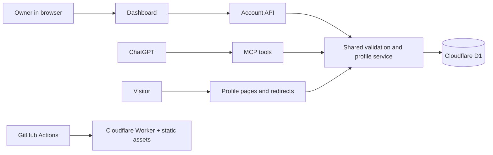

# Architecture

wya.im is one application with two ways to manage the same profile: the web dashboard and ChatGPT tools. Public profile pages and named redirects read that same data.

The pages, API, MCP endpoint, and service all run in the same Worker. The diagram separates their responsibilities, not separate servers.

| Part | Implementation | Purpose |
| --- | --- | --- |
| UI and routing | React, TypeScript, Vinext, Vite, Tailwind | Landing page, profile, dashboard; Next-compatible App Router file conventions |
| Hosting | Cloudflare Workers and Worker static assets | Server rendering, APIs, redirects, JavaScript and CSS |
| Database | Cloudflare D1 (SQLite) | Profiles, unique handles, current version, revision snapshots |
| Schema | Drizzle schema and committed SQL migrations | Reproducible database changes; runtime queries use the D1 binding directly |
| Business rules | Zod and shared service in `lib/` | Validate URLs, expand social usernames, scope writes to the owner, detect conflicts |
| ChatGPT connection | `/mcp` | Seven tools to read and edit the authenticated user's profile |
| Delivery | GitHub Actions and Wrangler | Test, build, apply migrations, upload the Worker |

## Authentication is the remaining hosting dependency

The working Sites preview uses the Sites gateway to authenticate the user. The gateway supplies trusted identity headers to `app/chatgpt-auth.ts`; the app never accepts an owner ID from a mutation payload. Sites also supplies the current ChatGPT account-linking integration.

Your own Cloudflare account does not include that gateway. The standalone entrypoint in `deployment/worker.ts` strips those headers and blocks account/MCP endpoints until independent authentication is implemented. Its deployment config disables public URLs and routes. This is an infrastructure deployment, not a public production launch.

The next implementation needs verified browser sessions and OAuth authorization for ChatGPT to call MCP on the user's behalf. Both must resolve to the same internal account ID. Entering an Instagram or GitHub username currently creates a link; it is not social login or proof of account ownership.

The Sites database and the database in your Cloudflare account are separate. Existing profiles will need an explicit migration, including an identity mapping, before switching hosting. `wya.im` DNS is not changed by this pipeline.

## Request examples

- `GET /alex` renders the visible links in Alex's profile.
- `GET /alex/github` resolves the stored destination with a noncached HTTP 302. Hidden links return 404.
- A dashboard edit posts an action and expected version to `/api/account`. The service validates it, saves the previous profile as a revision, and atomically updates the current record. Concurrent stale edits return a conflict.
- ChatGPT calls a tool such as `upsert_link`; it uses the same service and version checks as the dashboard. The model does not receive direct database access.

## Future generated HTML

Keep the structured profile as the source of truth. Add a layout representation and renderer so generated designs can reuse the same links and permissions. HTML export can be a separate output; if arbitrary generated HTML is hosted, it needs an isolated rendering boundary. R2 is an option for future uploaded assets or exports, but is not needed by this release. There is no separate API server, Redis, analytics service, billing system, or app-side AI generation API in the current implementation.
