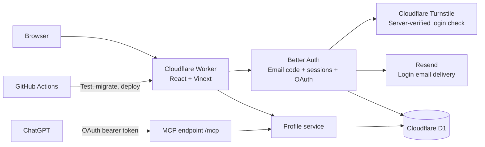

# Architecture

wya.im is one Cloudflare Worker with two ways to manage a profile: the browser dashboard and ChatGPT. Both use the same account ID, validation, profile storage, and revision history.

These boxes represent responsibilities within one Worker, except Turnstile, Resend, D1, GitHub Actions, and ChatGPT. There is no separate API server or AI API bill for the account-linking feature.

| Part                   | Implementation                            | Purpose                                                                                                             |
| ---------------------- | ----------------------------------------- | ------------------------------------------------------------------------------------------------------------------- |
| Domain registration    | Namecheap                                 | Keeps ownership and renewal of `wya.im`                                                                             |
| DNS, TLS, hosting      | Cloudflare                                | Domain routing, HTTPS, Worker, static assets                                                                        |
| UI                     | React, TypeScript, Vinext, Vite, Tailwind | Landing page, profiles, dashboard, sign-in and consent                                                              |
| Database               | Cloudflare D1 (SQLite)                    | Spaces, current usernames and fallback redirects, revisions, users, sessions, hashed codes, OAuth grants and limits |
| Authentication         | Better Auth 1.7.10                        | Passwordless email sign-in and secure browser cookies                                                               |
| Login abuse protection | Cloudflare Turnstile and D1 limits        | Verifies hostname/action, serializes code requests, reserves existing-account email capacity                        |
| Email delivery         | Resend Free                               | Delivers codes from `hello@wya.im`; no marketing emails                                                             |
| ChatGPT authorization  | Better Auth OAuth/MCP plugins             | OAuth authorization code + S256 PKCE, consent, scoped tokens                                                        |
| Business rules         | Zod and shared `lib/service.ts`           | Safe URLs, social usernames, owner isolation, optimistic version checks                                             |
| Deployment             | GitHub Actions and Wrangler               | Test, build, migrate D1, sync secrets, deploy                                                                       |

## Dashboard desktop

The desktop is labeled Home, its default links page is Socials, and the profile app is Bio. These labels are shared by owner and visitor menus, windows, and file navigation. The `desktop` system folder and `profile` route keep their identities. Migration preserves custom page titles as Markdown filenames and maps the old stock Home title to Socials.

The authenticated `/dashboard/{section}?space={id}` route renders the same `DesktopProfile` as public desktop pages and embedded previews. There is no nested preview desktop. Owners get edit controls on the profile and items, plus management apps in Start. These controls inject existing editors and workspace services into the shared window stack; the public component does not import dashboard editors or grant content writes. Make it yours saves the owner's color and typography through partial profile updates; visitor choices stay local. The OS profile form omits the appearance pickers and preserves unfinished name/bio edits when appearance changes. View as visitor uses the same visibility projection as the public service, hiding unpublished files, items and collection children. It displays saved content; unsaved layout drafts stay in the owner view.

`app-registry.tsx` defines each application's identity, window presentation, renderer and optional file resource. The desktop shell uses this registry for shortcuts, launchers and windows. `lib/desktop-entries.ts` gives files and folders a common identity and explicit move, rename, copy and pin capabilities. Its commands delegate to existing file services; they do not create a second persistence or permission layer.

`use-desktop-session.ts` restores open and minimized windows, stacking order, maximized state and positions from a validated, versioned localStorage record per space and owner/visitor mode. Restoration waits for current metadata and measured container width. Server-provided documents are reused after checking their metadata; missing documents load through the authorized endpoint, with concurrent reads coalesced per scope and file. Inaccessible or deleted entries are omitted. A stable loading surface hides the transient icon grid until restoration finishes. Saved records contain window and taskbar metadata only, never file contents, tokens or editor drafts. Taskbar pins are independent of running windows and can reference apps, files, or folders. Closing removes an unpinned entry; minimizing keeps its running indicator; closed pins remain launchable. Pins stay ordered before other running apps, survive Reset desktop, and are isolated by space and owner/visitor mode. Folder pins open their location in the shared Files window. Context menus on the desktop, Start menu, Files, and taskbar expose pin/unpin through right-click, long press, or Shift+F10. Metadata errors do not erase saved pins. Restored positions are clamped to the viewport before display, and mobile stacking does not overwrite desktop coordinates. Explicit navigation can still open its requested app. Empty desktops are remembered; Reset desktop clears window placement. Storage failures fall back to an ordinary working desktop. Embedded previews do not restore or save sessions. This is device-local continuity, not cross-device synchronization or offline editing.

The desktop is the default dashboard. Old `/experimental-dashboard` URLs redirect to the matching `/dashboard` section, preserving the selected space and legacy `?tab=` bookmarks. Authentication, ownership checks and existing item autosave are unchanged. Owner forms stay mounted when minimized and when viewing as a visitor; entry autosave flushes before leaving an editor or switching spaces. A new space starts a fresh desktop session. On mobile, only the frontmost window is shown. Both dashboard route prefixes remain reserved as handles and excluded from indexing. Public requests still receive public data only; entering owner mode requires the authenticated dashboard route. Shortcut order remains profile metadata. All document content uses the file tables described below.

Owners choose a **Main window** in Settings and save it explicitly. `mainWindowId` is space metadata, persisted through `update_profile`, and may reference a public app or a published file/widget. At mobile startup it overrides the local active-window choice; desktop sessions retain their saved arrangement. Explicit dashboard routes and document fragments take precedence. Resizing or changing the setting does not interrupt an open session. An unavailable choice falls back to the published default file, the first published file, then Bio; a failed initial document load opens Bio. Private apps and unpublished files cannot be chosen. This setting requires no database migration.

## Desktop files

All space documents use `space_files`, including the former Socials and Games tabs. A Markdown document has one stable UUID, filename, folder, private draft, published snapshot, appearance and optimistic version. There is no separate page entry, page editor, or page properties pipeline. Files and Text Editor share create, open, rename, move, copy, download, publish, unpublish and delete actions. Shared Properties changes filename, default document and navigation order without publishing draft content.

The standard creation quota is 30 `.md`, `.txt`, or `.widget` files per space, with 128 KiB of UTF-8 per file, plus 30 folders nested up to five levels. Migration can retain more than the creation quota rather than discard existing documents. Names are unique within their folder ignoring case. IDs remain stable through renames and moves. The protected system Home folder keeps its `desktop` identity, does not consume the user folder quota, and determines desktop membership. Moving a document out removes its icon without unpublishing it.

Migration `0017_markdown_files.sql` extends file storage and creates the legacy migration archive. `lib/markdown-file-store.ts` performs the idempotent conversion: it backs up the exact old profile JSON and page placement, creates deterministic file IDs for tabs, retains Markdown source, appearance, card IDs, aliases, order and default selection, and resolves filename collisions without overwriting existing files. Hidden tabs become unpublished drafts. Visible tabs receive the same content in draft and published snapshots. Existing ordinary files remain intact. Canonical `spaces.data` contains profile metadata, `defaultFileId`, a model-version marker and a compiled published-card lookup index; it no longer contains tab layouts or document source.

The compatibility adapter can project files into the old layout shape while applying an existing item mutation or restoring legacy history. That transient projection is never saved as another content source. Existing revision snapshots remain readable. New revisions keep file snapshots in `space_file_revisions`, one row per file, so multiple large files do not exceed the database row limit. Publication, unpublication, deletion and file properties create history entries; private draft saves do not. A shared atomic commit checks both the space version/data and the complete file ID/version manifest before changing files, metadata, history or the redirect index. Conflicts leave the original state intact. Explicit private saves use file versions without incrementing the profile version. Identical saves still validate ownership, schema and version, but skip the database commit and preserve timestamps.

Legacy browser window, taskbar and icon-layout IDs are remapped from tab IDs to file UUIDs before unavailable entries are removed. Old local page drafts remain recoverable in the shared file editor. Recovering a draft restores local editing only; it sends no server request. A conflicting local draft is not silently overwritten or discarded.

Files provides Back/Forward/Up, breadcrumbs, search, a location sidebar, folder creation, shared context menus and aligned Name, Type and Status columns. A click or tap selects; a double-click or double-tap opens. Enter opens unless configured for rename. Explicit Open actions remain immediate. Narrow windows collapse the sidebar and hide Type. Cut/paste moves files and folders. Copy reads an open editor's local snapshot without saving the source; Paste creates a private file with that source and appearance. Markdown/text uploads create private drafts. Downloads contain plain source, not appearance metadata.

Folders reject cycles, excessive nesting and nonempty deletion in the database write. Destinations must belong to the authenticated space. Private files are owner-only; public folder listings contain the system Home folder and ancestors of published files. Files, Home shortcuts and taskbar menus use the same commands and stable IDs. Dragging uses Pragmatic Drag and Drop; window dragging remains separate. Desktop icon arrangement remains device-local except for the existing owner shortcut-order metadata.

`/api/files` requires the authenticated owner, same-origin writes, a write quota and current file versions. Save changes only the private draft. Publish validates Markdown and copies name, source and appearance to the public snapshot, updating its visible-card index atomically. Unpublish disables its public content and short links while retaining the private draft. Delete removes the document. Public file endpoints return published snapshots only, even to a signed-in owner, and strip hidden cards and collection children before returning source. They use `no-store`; previously downloaded copies cannot be recalled.

Markdown documents support the same Wya links, projects, games, collections, Discord widgets and sections as the old tabs. `lib/file-documents.ts` validates rich blocks while preserving surrounding Markdown and unsupported inert source. Published card IDs preserve analytics and short links. Publication rejects short-link collisions with other published files. `lib/profile-files.ts` derives the shared published index, with legacy originals taking priority over copied identities. Only cards actually owned by a file in that index use short URLs and global analytics; a copied or conflicting card falls back to its direct destination. DOM fragments include the file ID; legacy bookmarks resolve to the owning file. Classic and Desktop both render published file snapshots, with local document selection rather than public `?tab=` parameters.

Appearance has Light, Dark dimmed and Full black presets, an independent main color, and curated heading/body fonts. Each file keeps separate draft and published appearance. Missing color/fonts inherit the space, and `{}` restores Light with inherited values. Legacy colors normalize to the nearest preset. Moves and copies preserve appearance; raw downloads do not include it. Inline `:font[text]{family="geo"}` directives remain in Markdown downloads and retain the curated-font validation.

Visual and read-only Code display the same Markdown draft. Visual uses the shared rich editor; Tiptap JSON is transient and never stored. Raw HTML is not executed. Text files render literally. Closing, minimizing, switching spaces and visitor preview checkpoint locally; they never save file content to the backend. Conflicts retain a recoverable local draft. Visitors can download or edit temporary copies without server writes.

### File editor persistence boundaries

`lib/file-draft-session.ts` owns the draft, confirmed server snapshot, version checks and serialized explicit commands. `use-file-draft.ts` adapts that controller to React and browser recovery storage. `use-desktop-files.ts` owns transport and the listing cache, applying mutation responses directly instead of re-fetching after each save.

- Text, block and appearance edits only update the local draft. Local recovery writes are coalesced for 300 ms and checkpointed before leaving; there is no backend autosave timer.
- Save or Ctrl/Cmd+S captures one snapshot. Identical and concurrent saves are deduplicated. New edits during a request remain pending for the next explicit save; errors never retry automatically.
- Publish saves at most one pending snapshot before publishing. If newer edits arrive during that save, publication stops so the user can review/save them. Deliberate file Trash also saves its current draft first so restoration retains it.
- Rename, pin, move and unpublish do not upload unsaved content. Properties reads persisted metadata; Copy and Download can read the local snapshot without saving it. Folder Trash checkpoints unsaved drafts locally, which remain recoverable after restoration.
- Recovery records are scoped to space/file, validated, and include their base snapshot. Another tab's recovery copy is never overwritten or erased. Storage failures keep edits in memory, show a Save/Download warning and block normal window closure. Browser unload warns while changes remain unsaved.
- Overlapping remote and local changes block writes without advancing the local base version. Reloading the page offers local recovery with an explicit conflict notice. Nonoverlapping metadata updates merge without replacing local text.

MCP exposes `list_files`, `read_file`, `create_file`, `save_file`, `publish_file`, `unpublish_file`, `move_file`, `file_properties` and `delete_file`, using the same authorized service as the dashboard. Read the current file before editing and use its version. Saving never implies publishing. `get_profile` exposes files and profile metadata, not a separate layout. Item tools accept `fileId`; `set_tabs` is no longer advertised.

## Sign-in and ChatGPT linking

1. The user enters an email at `/sign-in` and completes Turnstile. The Worker validates the token, hostname, and `login` action server-side, acquires a short recipient lease, and checks eligibility before creating a code. An unexpired delivered code stays valid: resends return `OTP_ACTIVE`, and the form lets the user enter that existing code. Better Auth stores a six-digit code hash in D1 and sends through Resend. Delivery errors return an error and remove the undelivered challenge; no false success response.
2. A code expires after five minutes, allows three verification attempts, and can be used once. Persistent IP and recipient limits plus global sending caps restrict abuse. Successful verification creates the internal user and an HttpOnly session cookie. Production cookies are Secure and SameSite=Lax.
3. The dashboard uses that session to resolve the owner ID. Mutation payloads never choose their owner.
4. ChatGPT connects to `https://wya.im/mcp`, discovers the OAuth server, registers an OAuth client, and starts authorization with PKCE. The user signs in with the same email and reviews `/consent`.
5. ChatGPT receives a token bound to `/mcp`. The Worker verifies its signature, issuer, audience, expiry, scopes, and current consent before calling the profile service. Browser cookies cannot authorize MCP calls.
6. `/connections` lets the user disconnect an app. This removes consent and its durable access/refresh tokens; MCP also checks live consent rather than relying on JWT expiry alone.

Scopes are `profile:read`, `profile:write`, and `offline_access`. Access tokens last five minutes; refresh tokens last 30 days. Dynamic client registration supports ChatGPT without a shared client secret. Client names supplied through registration are not verified identities; the consent page also shows the redirect destination. General client/resource administration and machine-to-machine grants are disabled.

The code reserves at most 90 login emails per UTC day and 2,500 per month, with one reservation per recipient per minute and five per hour. Unverified/new accounts can use at most 30 per day and 750 per month, leaving capacity for existing verified accounts. IP checks allow three requests per minute and 15 per day before challenge verification. Failed delivery attempts still consume a reservation. These caps protect the budget and can temporarily stop sign-in if exhausted. Resend handles delivery; Better Auth handles identity. Codes, keys, and email message bodies are never logged by the application.

## Storage and updates

Application tables are defined in `db/schema.ts`. Auth tables are managed by Better Auth and the committed additive migration `drizzle/0001_auth.sql`, initially generated from Better Auth 1.7.10. Keep the two sets of tables separate when generating future migrations, and do not overwrite an applied migration when upgrading auth.

- `GET /alex` renders visible links.
- `GET /alex/github` returns a noncached 302; hidden links return 404. Wya homepage and profile URLs are allowed as destinations. Internal short-link chains are resolved from stored data to their final destination, without fetching external URLs. Visible link saves reject known cycles, including aliases; every visit checks again to stop cycles introduced by later edits, restored history, renames, or concurrent writes. Resolution allows up to 10 stored links and returns 508 for a cycle or a longer chain. External sites' redirects are outside this check.
- Dashboard edits and MCP tools call the same service. Changed updates record a previous revision and check the expected version; unchanged saves preserve the version and create no history. Stale writes return a conflict.
- Supported social usernames expand into URLs. They are not identity verification or social sign-in.

Links have separate display names (`label`) and short URL segments (`slug`). Dashboard edits send `originalSlug` with `upsert_link` to identify the existing link when changing its slug. The shared service replaces it in place, preserves an omitted icon, rejects a missing original or a conflicting slug, and applies the same version and redirect-loop checks. A slug change retires the old path unless it is explicitly included in the item's aliases; the editor explains both cases before saving. Content history can restore the prior slug. Existing API clients that omit `originalSlug` retain upsert-by-slug behavior.

The Sites preview remains a separate deployment and database. It still uses its trusted Sites authentication gateway. The standalone Worker strips all caller-supplied Sites identity headers and only uses independent sessions/OAuth. Existing Sites profiles are not automatically attached to email accounts; any migration needs a verified identity mapping.

## Markdown sections and legacy actions

Section structure and item order are encoded in each Markdown file. Visual editing changes the private source; publication updates the public snapshot and compiled card index together. Removing a section unwraps its prose rather than dropping it. Empty headings can exist while editing but must be valid before publishing.

The existing account item actions and `set_layout` are compatibility adapters over files. MCP targets them with `fileId`; old API payloads and history may still contain a tab identifier, resolved through `legacyTabId`. They do not restore the retired tabs storage model. New applications should use file read/save/publish operations. Legacy import/conversion helpers remain only where old stored snapshots require them.

### Markdown grammar and editing

The grammar uses `remark-parse`, `remark-directive` and `remark-stringify`. `::link[Label]{slug="github" url="https://github.com/example"}` represents a link card; `:::section[Title]{id="socials"}` wraps a section. Link attributes also preserve stable IDs, aliases, platform, icon and visibility. Project, interest, collection and Discord cards use fenced `wya-item` blocks containing indented JSON. The code fence keeps quotes, nested games and metadata readable without HTML entity escapes; it is data, never executable code. Earlier `::item{data='JSON'}` blocks normalize to this format when opened, preserving surrounding Markdown and IDs. Local draft source and its base normalize together to avoid false edit conflicts; incomplete drafts are retained unchanged. Unknown block directives, invalid nesting, malformed attributes and null characters are rejected. Ordinary inline colon text remains Markdown. `react-markdown` renders the approved blocks through the existing card components, skips raw HTML, limits link protocols and renders validated HTTPS images without server-side fetching.

`lib/page-document-actions.ts` remains a compatibility compiler for older item actions. Authoritative source and appearance live in file snapshots. Public redirect resolution uses the compiled published index; it does not need to parse a document on every short-link visit. Public source filtering removes hidden cards and collection members before data leaves the server.

The unified editor offers **Visual** and read-only **Code** views of one Markdown draft. Visual uses Tiptap StarterKit for editable paragraphs, headings, emphasis, lists, quotes, code and dividers, with embedded Wya cards and sections. Markdown typing shortcuts format content directly in Visual, including heading and list prefixes, quotes, emphasis, inline code and code fences. Code displays the current source for selection and copying. Card dialogs update the local document, including newly added cards, without publishing individual changes. `lib/rich-document.ts` bridges the existing remark grammar and the transient editor document; Tiptap JSON is never stored. Unsupported Markdown constructs stay in inert nodes holding their original source, and an untouched document retains its exact source when switching views. The shared editor schema prevents cards from being wrapped in ordinary lists or quotes and prevents nested Wya sections. Empty section titles are editable drafts but fail publication validation.

Pasting a single recognized GIPHY/Tenor URL or direct raster image URL into an empty paragraph creates a media block. Pasting into prose, code or a selection follows normal paste behavior. Detection is local and does not probe arbitrary URLs on the server. The paste and its conversion are separate history steps, so Undo restores the original link. Media retains its source URL, offers Convert to link, and keeps that URL accessible if loading fails. Images use the official Tiptap image extension and share GIF resize controls: 384px by default, a custom width, or fill width, constrained by the document on mobile. Default-size images use standard Markdown; resized images use an image directive with source, alt text and size. Both ordinary files and page documents validate and render these forms.

Document changes use private file autosave and explicit **Publish changes** through `/api/files`. The old `/api/account/document` route remains a compatibility entry for old `publish_document` payloads, but commits Markdown files rather than restoring a tabs store. Recoverable browser drafts supplement server drafts and remain private. Visitors receive published source or edit a temporary copy; `.txt` remains literal text.

### Legacy import compatibility

A `.widget` file is a constrained Markdown document with one top-level Discord, GIF, p5.js, or code block. It uses the same `space_files` record, private draft, published snapshot, permissions, quotas, folders, and history as other files. Empty private drafts are allowed for setup; publication requires a valid visible block. The format registry and widget parser are shared by the API and UI. Renaming a single-block `.md` to `.widget` validates the existing source, and converting back to `.md` preserves the file identity and content.

Widget windows render the existing block components directly, with the OS window as the outer surface. Code is displayed, never executed. p5 continues to load the hosted sketch in the existing sandboxed iframe; a sketch must handle its own canvas resizing. Copying a document block into a widget creates an independent private file in the same folder and does not change the document. Linked widget references are not part of this format.

The separate page JSON menu is retired. New imports use `.md`, `.txt`, or `.widget` uploads in Files and create private drafts. Downloads return the current file source. `lib/tab-transfer.ts` and the authenticated `/api/account/import` boundary remain for validated old `wya.im/tab` payloads and historical compatibility. They assign fresh identities and resolve conflicts, then commit canonical files through the compatibility adapter. They do not establish a second live page model.

### Copy and paste

Item and section menus copy a versioned `wya.im/clipboard` payload. Sections include their items in the current draft order, including collection children. Copy flushes entry autosave first. Add → Paste previews content in the current tab; a section menu also accepts Paste item here. Browser clipboard denial falls back to manual text selection/paste. Pending layout changes must be saved or discarded before pasting; unfinished new items must be completed or cancelled.

`lib/content-clipboard.ts` validates the envelope and placement. It shares item validation, limits, fresh IDs and collision handling with tab import through `lib/portable-items.ts`. Pasting appends independent copies in one revision using the normal authenticated, ownership-checked mutation boundary. Hidden item flags are retained; the destination tab controls tab visibility. Existing destinations and image references remain unchanged. There is no database migration.

## Email, aliases and project tiles

Email uses the `email` preset and a normalized `mailto:` URL with one recipient plus optional subject/body. Other URL presets still require HTTP(S). Arbitrary mail headers, duplicate query keys, subject line breaks, embedded credentials and executable URL schemes are rejected. Public email buttons use mailto directly; short URLs and aliases resolve to the same mailto destination. Mail-client availability belongs to the visitor's device; no Resend message is sent.

Link items gain a stable `id` on creation or first edit and optional `aliases` (up to 10). Aliases are stored on the item, never as redirects to another slug; canonical slugs and aliases share a unique namespace per space. Renames retain the ID, aliases, section and position. Old primary URLs are retained only when explicitly added as aliases. Hidden/deleted items disable every alias. Resolver cycle tracking uses the item identity, so alternate aliases cannot evade loop detection. `createOnly` lets the dashboard reject accidental replacement of an existing item; older upsert-by-slug clients remain supported.

Projects render as compact list tiles with an optional square thumbnail, description and inline action links. Projects are structured items (`kind: project`) in the same JSON content: description, optional HTTPS cover URL and 1–3 labeled destinations. Their first button is mirrored as the short URL destination. The `upsert_project` action shares ownership, version, collision, loop, history and layout rules with links; ordinary link updates cannot overwrite project cards. Projects default to hidden on creation, while omitted visibility preserves it on edits. Public reads omit hidden cards. Project fragments use stable item IDs. Limits: 12 projects per space, 100 total items, 60-character titles, 800-character descriptions, and 30-character button labels.

Covers load directly in the browser with no referrer and a text-card fallback on failure. There is no server-side metadata/image fetching, image upload, or new storage binding. These external image URLs are part of text revisions and can be restored; their image content is controlled by the host. Future R2 project uploads require broader ownership/reference and cleanup handling. See `docs/ideas.md` for carousel planning; carousel rendering is not implemented.

## Operations and future work

The custom domain is attached in Cloudflare's dashboard. CI has no DNS permissions and preserves that attachment. Workers.dev and preview URLs stay disabled. Runtime secrets are Cloudflare Worker secrets, mirrored in GitHub Actions for deployment; local copies are ignored and permission-restricted.

Generated profile layouts should reuse structured profile data. Arbitrary hosted HTML would need an isolated rendering boundary. R2 stores current profile pictures; Redis is not required.

## Link presets and icons

`lib/link-options.ts` defines the shared preset and icon catalog. The dashboard, public cards, Zod validation, and MCP discovery use that catalog. Presets provide a label, suggested slug, destination hint, and default icon; they do not restrict the destination to a particular host.

`lib/social-links.ts` expands usernames and reads profile handles using the provider rules in `lib/social-presets.ts`. The 40 supported platforms are:

- Social: Instagram, Facebook, X/Twitter, Threads, Bluesky, Reddit, Pinterest, Telegram, Snapchat, Tumblr, Mastodon, and Pixelfed.
- Games and interests: Steam, itch.io, Lichess, Chess.com, Letterboxd, MyAnimeList, and AniList.
- Video and music: YouTube, TikTok, Twitch, SoundCloud, and Last.fm.
- Work and creators: GitHub, LinkedIn, Dribbble, Behance, Medium, Substack, GitLab, Codeberg, DEV Community, CodePen, Hashnode, Ko-fi, Patreon, Buy Me a Coffee, ArtStation, and DeviantArt.

The same rules recognize profile URLs saved with a generic preset. Public links show the handle below the display name, falling back to the short slug for other destinations. Detection uses the saved URL without new fields, migrations, or provider requests. Content links, invite codes, and opaque account IDs do not produce a username. Steam uses the custom `/id/name` profile address, not a private login name or numeric `/profiles/id` URL. Root profile subdomains on itch.io, Tumblr, ArtStation, and DeviantArt are also recognized; game, post, and artwork paths are excluded.

Mastodon and Pixelfed accept a full `@user@server` address or profile URL and retain the server in the displayed detail. Common servers are recognized automatically; other servers require selecting the matching preset. A random site's `/@name` path alone does not identify it as Mastodon. No WebFinger or account lookup is performed, so this is a URL-derived detail, not identity verification. The original title, aliases, and short-link routing are unchanged.

Links can store an optional `icon` ID independently of `platform` in its Markdown card payload and compiled lookup index. Old links use the preset default. An omitted icon in `upsert_link` preserves an existing override; `null` clears it. History snapshots retain icons with the rest of the link data. Icon SVGs are bundled with the app; there are no third-party icon requests or uploaded SVGs. Interface icons and the curated symbol library use Phosphor in regular weight, with filled radio indicators; social and brand logos use Simple Icons. Per-icon Phosphor SSR imports work in both server and client components without loading the full icon catalog or relying on context. Persisted icon IDs stay unchanged when switching icon renderers. Keep existing IDs stable when adding icons. The dashboard opens a Radix dialog with a lazily loaded browser: keyword search, five categories, quick picks, and batches of 36 results keep the form compact as the library grows. Selecting an icon updates the draft; saving the link persists it.

## Space service boundaries

HTTP account routes and MCP tools call the same `lib/service.ts` adapter. It supplies the Cloudflare D1 binding to `createSpaceService`; transport code must not implement a second set of ownership or mutation rules.

- `lib/space-service.ts` coordinates action validation, write limits, ownership/version checks, creation, preparation of edits, redirect validation, and no-op detection. The public read path filters hidden content here. `mutate()` remains the single entry point for account content changes.
- `lib/space-store.ts` owns space SQL, stored-profile hydration, owner-scoped account reads, database error translation, and persistence. Revision insertion and the version-checked update stay in one atomic D1 batch. It rereads username mappings after a write because another space can claim a fallback address without changing the original content version. Its unfiltered handle lookup and revision lookup are internal to the service; routes use the service's public/authorized methods instead.
- `lib/profile-types.ts` defines stored content and limits; `profile-action-schema.ts` validates action payloads; `profile-validation.ts` validates handles and destinations.
- `lib/profile-actions.ts` applies content/layout actions. `item-mutations.ts` shares addressing and placement rules while building links, projects, and interests separately. Collections and tab transfers retain their own modules. These functions do not acquire database or Cloudflare dependencies.
- `lib/model.ts` preserves existing imports as a compatibility facade. Domain modules import their specific dependencies directly.

A new widget normally extends its schema and content rules, then joins the changed-destination selection if it introduces outgoing links. It uses the same ownership, versioning, history, and persistence path. Add a new service branch only for an operation with distinct coordination needs, such as username changes or revision restoration. There is no generic repository framework, handler registry, or per-widget database service.

This refactor preserves the API, error statuses, mutation/rename quotas, schema, history semantics, and redirect behavior. Tests exercise the service against SQLite with the actual migrations, including competing writes, reserved names, ownership, failed-claim rollback, and no-op edits. The separate picture service keeps its existing object lifecycle.

## UI and transport boundaries

- `app/[handle]/page.tsx` loads a public space, resolves handle redirects, and assembles the page. `app/components/profile-card.tsx` renders identity, tabs, and sections; `profile-item.tsx` selects the renderer for each content kind. The dashboard preview uses these same components.
- `app/dashboard/workspace.tsx` composes the shared desktop, owner controls, and management windows. `app-content.tsx`, `apps.ts`, and `start-menu.tsx` define management content and navigation. `use-workspace.ts` coordinates requests, version conflicts, editor transitions, and autosave flushing. `use-layout-draft.ts` owns unsaved ordering and tab selection per space. The links, profile settings, history, and ChatGPT panels live in separate files beside their editors. There is no global state framework.
- `app/mcp/route.ts` verifies OAuth tokens and current consent. `lib/mcp-handler.ts` handles JSON-RPC and tool calls; `mcp-tools.ts` holds discovery metadata. Both browser and MCP mutations still use the space service.
- `app/globals.css` is the stylesheet entry point. It imports `app/styles/` in cascade order: base, public profile, workspace, editors, widgets, metrics, and legal pages. Keep that order when adding rules; later responsive overrides rely on it.

Authored source uses Prettier (`npm run format` / `npm run format:check`). CI checks formatting alongside lint, types, tests, and the build. Generated output remains outside the formatting pass. Add features to the existing focused module before introducing another layer.

## Multiple spaces and usernames

Hosted Free accounts can create 2 spaces; hosted Premium accounts can create 10. Self-hosted installs include all features without a paid space cap. `WYA_HOSTING_MODE` is trusted server configuration and defaults to `self-hosted`. `account_plans` stores the server-managed Premium access deadline. Space creation counts existing spaces and reads that deadline in the same conditional SQL insert, so concurrent requests cannot bypass the limit. Expiry or downgrade preserves every existing space and blocks only new creation above the current limit. `spaces.id` is stable across username changes; `user_id` is always resolved from the verified session or OAuth token. Each space has independent profile JSON, links, version, and `space_revisions`. Database triggers retain exclusive current usernames.

`space_handles` maps each current username and at most one previous username directly to a space ID. Only current usernames are exclusive. Renaming makes the old username available immediately and retains it as a fallback redirect until anyone claims it or the space renames again. A second rename removes the earlier fallback. Creation and renaming can both claim a fallback, including from another space on the same account. Database triggers transfer the mapping atomically; concurrent claims have only one winner. Claims never transfer profile content, links, history, account access, or the stable space ID. Public profile aliases redirect temporarily to the current username; short-link aliases redirect to the current username and slug before the usual noncached external redirect. Hidden/deleted links remain unavailable through aliases. After a claim, all paths under that username belong to the new owner; a missing slug returns 404 rather than falling through to the previous owner. Restoring content history does not roll back the username.

The dashboard stores the selected space ID in its URL. The account API and MCP mutation schemas accept `spaceId`; the service checks ownership on every read/write. Omission remains compatible for accounts with exactly one space, but is rejected when multiple spaces exist. ChatGPT can call `list_spaces` to choose a space, then `get_profile` and the existing editing tools, or `rename_space`. Existing OAuth scopes cover the account's spaces; consent copy makes this explicit.

Migration `0002_spaces.sql` copies existing profiles and history into the new tables without changing usernames or versions. Legacy tables initially remain intact. Bridge triggers copy writes from the prior Worker during the migration/deployment interval, and reject legacy writes once a newer space version exists. New code writes only the space tables. Migration `0007_retire_legacy_profiles.sql` completes the transition: it copies missing legacy spaces and retained history, checks ownership and version/content conflicts, then drops `profiles`, `revisions`, and their bridge triggers. Existing newer spaces, stable IDs, usernames, pictures, and the latest-50 history policy are preserved. Any conflict aborts the migration for manual reconciliation. No space deletion is exposed. Migration `0003_reclaimable_handles.sql` replaces the reservation triggers and prunes historical aliases to the immediately previous username, using the latest rename revision rather than original handle creation time.

## Bio mentions and links

Bios remain plain text with a 280-character limit, including in history and MCP actions. `lib/bio.ts` parses `@handle` into a Wya profile link, platform-prefixed usernames into external profile links, and full HTTP(S) URLs into direct links. Supported prefixes are `github:`, `instagram:`, `linkedin:`, `youtube:`, `tiktok:`, `x:`, `bluesky:`, `telegram:`, and `twitch:`. Other destinations can use a full URL. Wya mentions follow the current username mapping: a fallback while unclaimed, the new owner after a claim, or 404 after an earlier fallback is removed.

The shared `BioText` renderer produces escaped React text and anchors, never user HTML. It leaves email addresses and invalid mentions alone, rejects credential-bearing URLs, and separates sentence punctuation from links. There are no outbound lookups, identity claims, mention notifications, or directory searches. Links open in a new tab with `noopener noreferrer ugc`.

The dashboard and new-space form offer an Insert mention helper, character count, and draft preview. Insertion replaces the textarea selection and only persists when the parent form is saved. MCP create/update schemas describe the same plain-text notation. This feature needs no schema migration or new service.

## Space pictures

Each space has one optional `spaces.picture_key`, stored outside the JSON used for revisions. Picture updates increment the space version but create no history entry. Restoring a revision preserves the current picture. The dashboard keeps unsaved profile text when a picture is saved.

The browser accepts JPEG, PNG, and WebP up to 5 MiB (shown as 5 MB), applies orientation, lets the user crop/pan/zoom/rotate, and exports a 512×512 WebP at quality 0.85 (PNG fallback if WebP encoding is unavailable). The original never leaves the browser. Canvas export strips original file metadata. Files the browser cannot decode are rejected; there is no HEIC, SVG, or animation support in the editor.

`PUT /api/pictures?spaceId=…&expectedVersion=…` accepts the optimized bytes, with a signed-in session and same-origin check. The Worker checks ownership/version before reading, counts streamed bytes independently of Content-Length, and checks the raster MIME/signature. It does not decode, resize, or optimize images. Clients bypassing the editor can upload an unoptimized raster within 5 MiB; dimensions and compression are not server-enforced.

A private R2 bucket `wya-im-pictures` is bound as `PICTURES`. No public bucket, S3 credentials, Cloudflare Images, or image-processing service is needed. `GET /api/pictures/:key` exposes only an object currently referenced by a space. It uses a random key, fixed raster content type, nosniff, and revalidation/ETags. New uploads get new keys; old URLs return 404 after removal/replacement. Browser copies already downloaded cannot be recalled.

Upload order: reserve an object key in `picture_objects`, write R2, compare-and-swap the space version/key in D1, then delete the prior object. Failed deletion is retried by an hourly sweep of unreferenced objects older than an hour (up to 100 per invocation). This also removes abandoned uploads. An ambiguous D1 failure does not eagerly delete the new object because the update may have committed. The ledger is operational cleanup metadata, not recoverable photo history.

MCP `get_profile` returns the current picture URL and an authenticated dashboard editing link. `copy_profile_picture` copies bytes into an independent object between two owned spaces; `remove_profile_picture` removes it. Both require explicit space IDs and the current version. New pictures must be uploaded in the dashboard; conversation attachments are not fetched by the server.

### Public avatar URLs

`GET /{handle}.png` returns that space's current picture directly, including case-insensitive handles and active aliases. Uploaded JPEG/PNG/WebP bytes retain their original content type and compression; the `.png` suffix is a stable address, not a request to transcode uploaded pictures. With no picture, the response is a real 256×256 PNG containing the first two name initials. The bundled font covers accented Latin, Vietnamese and Cyrillic; unsupported names use the ASCII handle initials to avoid runtime font or emoji downloads. Missing profiles return 404, while database/storage/rendering failures return a non-cacheable 503.

Both Worker entrypoints handle these requests before framework rendering or session lookup. A cold request uses one indexed handle-to-space query selecting only public name/handle and picture key, then reads R2 or lazily generates the initials PNG. Direct delivery avoids the extra HTTP request and database lookup that redirecting to the existing Worker asset endpoint would require. A Cloudflare Cache API response cache and browser cache use a maximum 60-second freshness window; cached hits skip D1, R2 and PNG generation. A bounded 128-entry in-memory cache also reuses completed PNG bytes across profiles with identical initials, without retaining request streams or in-flight promises. `Age` preserves the remaining freshness on edge hits, query strings and cookies do not fragment the public cache, and ETags support bodyless 304 responses. Unknown profiles are cached for at most five seconds. Cache failures fall back to a fresh read; error responses are not cached. `HEAD` returns image metadata without loading an R2 body or rendering initials, and never seeds an empty cached `GET` response. Public CORS allows image reuse in external pages and canvases.

Picture replacements/removals, name changes, alias claims and account deletion can therefore take up to 60 seconds to appear through these avatar URLs. The existing `/api/pictures/:key` revocation behavior is unchanged. Existing literal handles ending in `.png` retain their profile pages when they collide with an avatar URL; `/api/avatars/{handle}` is an unambiguous alternative, and `/{handle}.png.png` addresses the avatar of a literal `.png` handle. Customer domains continue to expose only their own profile/short-link namespace, not this global avatar API. No new database migration, storage bucket or paid image service is required.

## Request and resource limits

Account/MCP JSON is limited to 16,000 streamed bytes before decoding. Auth bodies (including OAuth forms) are limited to 32,000 bytes before the auth library parses them. Missing or inaccurate Content-Length cannot bypass these bounds; over-limit streams are cancelled. Pictures retain their separate 5 MiB streaming cap.

All profile writes, including unchanged saves, share a D1-backed account budget with picture upload/copy/removal: 30 attempts per minute and 300 per UTC day. Renames additionally allow ten attempts per UTC day. These limits apply across dashboard and MCP, across all spaces, and across Worker instances. They do not change ownership checks or the chosen immediate-reclaim username policy.

Migration `0005_security_limits.sql` creates the shared counters and recipient leases. It retains the latest **50 content revisions per space**, pruning older revisions during migration and after subsequent inserts. Old revisions beyond this window cannot be restored. Current content, usernames, and pictures are unaffected by pruning. Legacy bridge tables remain until migration `0007` retires them. Hourly maintenance removes expired counters/leases alongside picture cleanup.

Standalone sign-in, consent, dashboard, connections and auth API responses forbid framing (`frame-ancestors 'none'` and X-Frame-Options DENY) and use private no-store caching. Picture sandbox headers are preserved. GitHub Actions are pinned to immutable commits.

Turnstile and quotas reduce automated abuse; finite free-tier mail capacity is not an availability guarantee against a distributed attacker with valid challenges and verified accounts. Monitor quota consumption and delivery failures. Never log codes, tokens, or recipient addresses when doing so.

## Trash and permanent deletion

Files exposes a private Trash view for whole `.md`, `.txt`, and `.widget` files and recursive folders. Editing individual document blocks continues to use editor Undo and version History. All canonical removals pass through `commitMarkdownFiles`: IDs absent from the next snapshot are archived, while physical delete/reinsert operations used for updates are not. Folder deletion archives its entire subtree in the same guarded transaction as removal and public-index rebuilding.

Migration `0018_space_trash.sql` stores entry metadata separately from per-file and per-folder snapshots. Trash is limited to 100 contained items and 32 MiB per space, with no automatic expiration. A full Trash blocks further deletion rather than silently discarding content. Archived items do not count against active file/folder quotas. Private API and MCP actions require ownership and entry versions; public file queries never read the archive.

Restoration retains IDs, draft contents, appearance, and folder structure, increments versions, and restores files as unpublished drafts. Original folders are reused when present; missing parents fall back to Home. Name collisions get a numeric suffix, and active quotas and maximum nesting depth are checked before any write. Empty Trash uses an explicit ID/version snapshot so newly deleted entries are not accidentally purged.

Permanent deletion removes archive records and retained application history containing those files, including old migration backups, then retains ID-only tombstones to prevent old revisions from resurrecting them. Active Trash IDs are also excluded from ordinary History restoration. This does not erase external infrastructure backups. Guarded batches check space, file, folder, and requested Trash versions to reject concurrent stale writes. Open editors flush before file or recursive folder deletion; removed documents close after success.

## Discord server widgets

Discord widgets use `kind: "discord"` in the existing item JSON, with `discord.guildId` as their only external-service configuration. `upsert_discord` shares item addressing, stable IDs, placement, ownership, optimistic versions, visibility, history and Markdown downloads. New widgets default to hidden at the API; the dashboard explicitly submits its visibility checkbox. Short URLs return to the widget's file fragment. No schema migration or bot credentials are needed.

`GET /api/discord-widget?guildId=...` is an authenticated editor preview, limited per user. Public requests use `handle` and `slug`; the server verifies current item and tab visibility before accessing shared server data. API responses are private and uncached so hiding a widget cannot leave a publicly cached route response.

`lib/discord-widget.ts` fetches a fixed Discord API endpoint with a seven-second timeout, no followed redirects, a bounded response and validated output. Invite and avatar URLs are restricted to Discord hosts and known paths. Successful responses have a 15-minute TTL in a bounded per-isolate cache and Cloudflare's edge cache. Concurrent requests for the same guild share a fetch. Failures have a short cooldown; Discord rate-limit responses respect Retry-After, and uncached requests use shared D1 limits. Edge caches are local to a Cloudflare location, not a global single-fetch guarantee. Presence data stays out of D1 and revision history. The UI does not poll; a later load refreshes an expired cache entry.

The shared public/preview component uses the existing profile tile and theme, shows channels, members, the supplied online total and an optional join button. It reserves a scrollable body area while loading or unavailable. The editor accepts a server ID or widget URL. The dashboard editor opens the English/pt-BR setup guide in Help, under Widgets. Help keeps its small guide catalog separate from the editor, with numbered sections and a return action that preserves an unfinished Discord draft. Existing entries autosave; adding a new widget requires an explicit Add action.

## Interests and game catalog

Games are `kind: "interest"` items in Markdown card payloads, with `interest.type: "game"`. The type registry in `lib/interests.ts` owns labels, icons and status wording. The shared editor, compact tile, cover fallback and catalog-result shape can serve future anime, movie, series and music types. Only games are currently enabled; future types still need validation, appropriate providers and their access terms.

An interest stores its personal note, optional status, favorite flag, hosted HTTPS cover, optional outgoing URL, and optional catalog reference. It retains the same stable ID, global slug/alias namespace, 100-item cap, files/sections, ordering, ownership, optimistic version checks and revision history as other items. New interests start hidden. No image upload or R2 lifecycle is added: these covers are external URLs and historical URLs can eventually become unavailable.

`GET /api/catalog` and the MCP `search_catalog` tool call the same authenticated catalog service. `lib/game-catalog.ts` adapts IGDB results to `CatalogItem`, handles server-side Twitch tokens, escapes search syntax, times out upstream requests and caches bounded results. Only fixed Twitch/IGDB endpoints are fetched. Secrets never reach the browser. Add → Game opens the individual-game editor with search, select, and add; titles and covers come from the catalog with no title, description, cover, or tracking fields to fill in. Optional buttons reuse the project button editor and renderer: up to three named HTTP(S) links, with the first becoming the short URL destination. Omitted buttons are preserved; an empty list removes them. The dashboard restores the catalog destination after removing the last custom button. New games are visible when added. Replacing a game keeps its existing short URL, aliases, and visibility. Saving uses the same `upsert_interest` action through the dashboard or MCP. Stored metadata is a user-editable snapshot, not verified play activity. No API call is needed to render saved items.

A game without an outgoing URL has a plain title; its short URL and aliases resolve to the containing profile tab and stable item fragment. Hidden/deleted items remain unavailable. Games with destinations participate in the existing redirect-loop checks. Search and selection alone never publish an item.

## Collection widgets

New game content uses a `kind: "collection"` entry with `collection: {type: "game", items: [...]}` in its Markdown card payload. A widget occupies one position in a file/section; its ordered children retain the established interest item shape. No SQL migration or automatic conversion of existing games is needed. Widgets cannot contain other widgets. The limits are 1–20 games per widget and 100 total entries per space, counting both widgets and their children.

`lib/collection-types.ts` defines bounded input schemas. `lib/collections.ts` handles collection updates, explicit grouping, the shared address namespace and public filtering. The collection editor reuses catalog search, cover fallback, and button editing. Add → Game Collection opens the grid editor. New collections have an optional title, catalog multi-selection, optional per-game links and visibility. New collections use Add collection; existing collections autosave valid changes. Ordering uses accessible move buttons. Per-game link fields stay mounted while collapsed, remain associated with the collection save form, and reopen with focus when browser validation finds an incomplete button. Public grids show two rows (four columns in a wide container, two in a narrow one) and expand on demand. A direct fragment to a collapsed child reveals it. A nonempty collection label renders as a section separator above the grid; an empty label shows no public heading. Omitted labels preserve existing titles on updates. Untitled collections use “Game Collection” in dashboard controls. Covers keep accessible game names and hover titles without visible captions. Collections show the cover grid directly on the profile background, without an outer card, border, shadow, or inset padding. Individual covers retain their borders. Catalog attribution appears once in the dashboard, outside the public profile.

`upsert_collection` accepts a full ordered `entries` list. Its URL slug is editable through the dashboard or `originalSlug` plus `slug` in the API. Renaming preserves the collection ID, child URLs and file/section position, and retires the old collection URL. Parent and child slugs and aliases share the same collision checks. New children use `{game: {title, source, coverUrl?}, buttons?}` from catalog search; existing children use `{id, buttons?, visible?}`. IDs must belong to that widget. Omitted child buttons/visibility retain their saved values; explicit empty buttons clear the destination. New games start with no buttons. Collection covers retain the catalog destination unless buttons explicitly override or clear it. Button fields are only added by the user. Omitted children are removed on save. New widgets default to hidden at the API, while the dashboard explicitly submits its visibility checkbox. Catalog duplicates are rejected within a widget.

`group_games` explicitly moves existing standalone games from one file/section into a new widget at their first existing position, retaining children's IDs, slugs, aliases, visibility, personal metadata and buttons. It requires confirmation in the editor and refuses mixed locations. Dashboard users must save/discard layout drafts first. Existing games otherwise continue to render and edit normally. History can restore the state before conversion.

Short URL lookup and collisions include nested games. A hidden parent disables every child; public reads remove hidden children before serialization. Child links without a destination resolve to their containing tab and stable fragment; widget short URLs resolve to the widget fragment. Updating visible widget children runs the same bounded loop checks as other links. Deleting a widget removes its children and disables their addresses, with revision restoration available. Ownership and optimistic version checks are inherited from the space mutation service. MCP exposes both collection actions; `get_profile` returns children with their stable IDs. `set_layout` addresses widgets within a Markdown file, not their nested children.

The collection wrapper and editor primitives can support future media types, but only games/IGDB are enabled. Anime, films, series and music need their own provider adapters and validated type definitions.

The standalone Game editor only edits that game. Collection conversion remains an explicit MCP/API action and is not shown beneath the game form.

## Dashboard navigation

Dashboard sections have authenticated routes including `/dashboard/files`, `/dashboard/profile`, `/dashboard/domains`, `/dashboard/metrics`, `/dashboard/chatgpt`, and `/dashboard/history`. The `space` query parameter keeps deep links scoped to the selected space. The desktop taskbar and Start menu identify the current space; switching spaces preserves the current section. `/dashboard` opens Files; retired `/dashboard/links` and `?tab=links` bookmarks also resolve to Files, while other older `?tab=` bookmarks retain their matching section.

Section links use browser history without remounting the workspace or refetching the account. Back/forward navigation flushes pending entry edits and loads a different space only when needed. Layout drafts stay in memory across sections and spaces. Saves preserve the current section URL.

## Entry autosave

Existing links, projects, games, and game collections save after a 1.5-second pause. New entries still require an explicit Add action; section/tab placement and page ordering still use Save layout. `EntryAutosave` serializes requests, skips untouched/reverted values, and pauses failed snapshots until an edit or explicit Retry. Native field validity prevents incomplete button rows from being sent. The editor reports pending, saving, saved, invalid, or error states; Discard unsaved closes the editor without undoing successful earlier saves.

Switching entries, dashboard sections, spaces, or profile tabs flushes pending edits first. Failed or incomplete edits keep the editor open. Browser navigation warns while unsaved changes remain. Existing ownership checks, optimistic versions, revision history, and mutation rate limits apply unchanged. Game collection saves match newly persisted catalog children to their server IDs so subsequent edits preserve their URLs.

Autosave keeps existing-entry inputs enabled while a write is in flight. The queue serializes later edits; workspace writes use the latest confirmed version and a synchronous in-flight guard. Rows use stable item IDs (or the matching legacy ID fallback), so slug changes preserve the mounted editor and caret. Status controls reserve their space, and URL guidance stays visible to avoid shifting the form after save acknowledgements.

## Space analytics

PostHog collects explicit public `$pageview` and `wya_item_click` events through `PublicAnalytics`. It mounts on the homepage and resolved profiles only, with cookieless mode, no persistence or identification, and no autocapture or session recordings. DNT/GPC prevent collection. A send allowlist removes destination URLs, labels, query strings, referrers, and other SDK enrichment. A SHA-256 namespaced space ID prevents exposing legacy account-derived IDs and preserves history across handle changes. Item IDs preserve attribution across edits and movement into collections. This is an attribution key, not an authentication secret.

Dashboard → Analytics calls `GET /api/metrics?spaceId=…&days=7|30`. The server authenticates the caller and resolves an owned space before any cached result. A project-restricted PostHog read key stays in Worker secrets. Fixed HogQL queries fetch daily UTC aggregates by hashed space ID; the browser cannot submit SQL, arbitrary projects, or filters. Five-minute bounded in-memory caches and in-flight deduplication reduce queries. Shared D1 rate limits protect the upstream API across isolates. Current profile data supplies labels, so renamed items keep their counts and deleted items appear as “Removed item.” Responses use `private, no-store`.

The initial metrics are event totals, a daily chart/table, and top ten items for seven or thirty days. Clicks aggregate all links/buttons belonging to an item, including games within collections. Direct short URLs and aliases are not tracked, and no historical Cloudflare data is imported. Privacy blockers can undercount; owner visits and spoofable browser events can inflate counts. These are approximate engagement signals, not verified conversions or unique-person counts. Missing configuration and upstream errors are distinct from genuine zero activity. No schema migration or onboarding is included.

## Optional onboarding

After a user has a space, the dashboard offers one screen with three optional, single-choice questions: what they do, why they are here, and how they found us. Existing accounts without a survey record see it once too. Continue accepts partial or empty answers; Skip stores a permanent dismissal and discards any selected answers. Creating or switching spaces does not repeat the survey. If saving fails, Continue without saving permits access for the current session; a later visit can prompt again because no dismissal was persisted. Your profile → About you lets the account owner update or clear answers later; clearing leaves the dismissal in place.

Migration `0006_account_onboarding.sql` adds a separate account-level table. `lib/onboarding.ts` owns stable answer codes, display labels, and strict validation. The onboarding service stores only the current answers, completion/skip status, and update time. The session-authenticated `/api/account/onboarding` endpoint validates origin, JSON type, a 1 KiB body limit, and the shared account write quota. Owners cannot be selected in the payload. Responses are private and not cached.

Answers never enter profile JSON, revisions, public pages, document downloads, MCP tools, or PostHog events. Include `account_onboarding` when handling manual account erasure. There is no age collection, new eligibility gate, admin reporting UI, or analytics identification in this feature. The existing 18+ policy is separate.

### Public page styles

A space can choose Classic or Desktop in Dashboard > Profile > Page style. The optional `pageStyle` field lives in the existing space JSON and revision history; older spaces default to Classic. `update_profile` accepts the same validated field from the dashboard and MCP. No database migration is required.

Desktop renders published files as windows, using the shared document renderer and item components with Classic. Unpublished files and hidden items are removed at the service boundary. Stable item identities preserve short links and analytics; fragments resolve the containing file. Window position, stacking and visitor color changes are browser UI state only, never profile writes. Small screens and the dashboard preview show one active window with a bottom dock. Window state and drag bounds live separately from content rendering in `app/components/desktop-profile`.

## Custom-domain routing

`space_domains` stores one hostname per space, independently of profile JSON and revisions. Unverified claims do not reserve a hostname globally; a partial unique index permits only one verified owner. The authenticated `/api/domains` endpoint checks space ownership and request origin, limits mutations, and serializes provider changes with a short database lease.

`lib/domain-service.ts` coordinates DNS ownership verification and Cloudflare for SaaS registration. `lib/domain-provider.ts` contains the bounded provider/DNS requests. `deployment/domain-routing.ts` maps an active hostname to its space before the application router runs. Client-supplied routing headers are removed before a trusted header is added; private routes stay on the canonical Wya origin.

`lib/public-address.ts` and the public address context keep profile/tab/item URLs consistent in both Classic and Desktop layouts. Custom domains use `/` and `/:slug`; canonical Wya URLs retain `/:handle` and `/:handle/:slug`. Optional Wya redirects use temporary responses so changing the setting or removing the domain remains reversible. Metadata identifies the active custom domain as the canonical address even when both addresses are usable. Public analytics retain the stable space ID and Wya pathname across domains.

Domain checks run outside the visitor request path. A five-minute dispatcher atomically claims up to 1,000 due registrations and sends small batches to Cloudflare Queues. D1 stores the due time, failure count and recoverable delivery lease; each job carries registration and dispatch identities so delayed deliveries cannot affect a replacement registration. Consumers process at most three domains sequentially per invocation, with two concurrent consumers. Healthy domains are checked about every six hours, pending domains about every five minutes, and failures back off with jitter up to one hour. Lost or exhausted deliveries become eligible again after their lease expires. Hourly picture/security cleanup runs separately.

`lib/domain-cache.ts` coalesces concurrent hostname lookups and retains at most 1,024 entries and 64 pending reads per database binding in each Worker isolate. Active entries live up to 15 seconds from the start of their database read; missing/inactive entries live up to one second. Hits never renew TTL, failures never serve expired entries, and verification expiry remains a hard deadline. Domain mutations invalidate before and after their writes in the current isolate, including while provider removal is pending. Other isolates, handle changes and direct database edits propagate within the cache TTL; this is bounded propagation rather than an instantaneous global purge. Public page bodies and private data are not cached by this layer.

Fresh status is required for routing; ownership loss, DNS mismatch, inactive certificates, removal, or status older than 48 hours disables the domain and its Wya redirects. Queue errors do not extend verification freshness. Aggregate dispatch/consumer logs report backlog samples, oldest due/verification ages, retries and invalid messages without hostname or token values. The dispatch budget is not a measured request-throughput or domain-capacity guarantee. Deployment setup is in `docs/deployment.md`; the local HTTP benchmark is documented in `docs/custom-domain-load-test.md`. Hosted Premium decisions and launch pricing are documented in `docs/custom-domain-billing-plan.md`.

## Feedback and support apps

The authenticated desktop includes Feedback and Support shortcuts, also available from Start under Guides and through `/dashboard/feedback` and `/dashboard/support`. They remain owner-only and are absent from visitor desktops. Opening assistance does not require completing an unrelated item draft. Existing window selection, double-click activation, pinning and positioning behavior applies.

Support is email-only at `support@wya.im`. The app opens the user's email client or copies the address and explains that Alex, the solo maker, replies personally, so a response may take a little time. Opening Support does not submit account or space metadata. The community link remains available for general conversation. Legacy `POST /api/contact` requests receive a noncached `410 Gone` with the email address; the route does not read the request body, inspect a session or send a message.

Feedback uses `useReportForm` in the browser, `createReportHandler` at the HTTP boundary, and `submitReport` for validation, metadata and delivery. `/api/feedback` selects the server-only `DISCORD_FEEDBACK_WEBHOOK`; the destination is never client input. The desktop app and footer dialog use the same Feedback form.

The strict report schema accepts the message, optional topic, language and selected space ID. Identity comes from the authenticated session; an owned-space query supplies the selected space's name, handle and ID, and the account service supplies plan and hosting mode. The bounded Discord embed includes reporter name/email/account ID, selected-space details, plan, hosting, language, site origin, timestamp and reference. An optional topic is ordinary report data. The same reference is returned to the form after confirmation. Metadata uses an explicit allowlist: cookies, session tokens, arbitrary headers and payment credentials are never forwarded.

Feedback permits 20 deliveries/hour and 100/day per account, plus 6 attempts/minute per account and 30 attempts/minute across accounts at a destination. Destination hashes scope the D1 counters without storing the webhook secret. Pending hourly/daily reservations are refunded on failure or a later quota rejection, while attempt limits continue to bound upstream failures. Errors return `Retry-After` and `retryAfter` seconds, and the shared hook displays a localized cooldown without losing the editable draft. Delivery never retries automatically because an unconfirmed timeout may already have delivered. Mentions are disabled, text is escaped, redirects are refused, and upstream errors are sanitized.

The Feedback form and privacy page disclose which account details are sent through Discord. No report content is logged or stored in D1. Feedback delivery errors point to `support@wya.im`; `contact@wya.im` remains the legal/privacy address. Support email contains only the message and details the sender chooses to provide. Feedback delivery is not a two-way Discord chat or ticket system, and no response-time SLA is promised. No database migration is required.

Desktop navigation uses shared Content, Apps, Settings, and Guides categories in the Start menu. Help is available under Guides, initially with Discord widget setup in the Widgets section. Item editors use the OS window title and close control without a second card header. Transient item-editor windows cannot be pinned because their content depends on the current edit session. Paint, Text Editor, Analytics, and History are apps; Use ChatGPT is a setup guide. Profile viewing and editing share one window and taskbar entry. The authenticated profile route opens its edit view, and switching back to the public view keeps the editor draft mounted. Only authenticated routes inject private apps and the profile editor. The editor's viewing-mode control sits outside the shared public desktop; visitor preview still uses `visibleProfile` and does not grant mutation access.

Space typography is an optional `font` value in profile JSON (`original`, `system`, `serif`, or `mono`), validated by the same `update_profile` boundary as color. It survives unrelated changes and revision restores without a database migration. Both public layouts apply curated font stacks only to space content; desktop controls and editing forms keep their own typography. Owner appearance changes save individually and do not remount profile drafts. Visitor appearance changes stay local to the visit.

## p5.js document blocks

The `/p5` slash command embeds a public p5 editor link or an official iframe snippet.
Only the validated p5 URL and display title are stored, using
`::p5{url="https://editor.p5js.org/USER/sketches/ID" title="Sketch title"}`.
Iframe snippets are parsed in a detached template; their HTML is never inserted.
A title lookup reads the official project API without retaining source.

The view loads `https://editor.p5js.org/USER/full/ID` (the editor's Share / Embed URL) directly in a lazy iframe.
p5 hosts and runs the project's current files, assets, library versions, and shaders.
Saved changes on p5 appear when the frame next loads or Reload sketch is clicked;
there is no polling or live synchronization of an already-running frame. Wya does
not download a source snapshot or bundle a local p5 runtime. Standalone `.js` URLs
are no longer accepted because they are not hosted sketch pages.

The fixed cross-origin frame permits scripts, its own origin, and pointer lock.
Popups, forms, downloads, and top navigation stay blocked by its sandbox. There is
no local drawing bridge, network proxy, or host pause API. Input and sketch controls
belong to the hosted page; Wya provides Reload, Edit, and Open original. Browser
same-origin rules prevent Wya from inspecting sketch errors or its canvas size.
The responsive frame therefore uses a stable 4:3 viewport.

The card conceals the hosted page's 42px navigation banner with an enlarged,
offset iframe; this provider-owned height is isolated in `--p5-provider-header`
and must be rechecked if p5 changes its navigation. Wya's title, p5/author credit,
and actions form a themed overlay revealed by desktop hover or keyboard focus.
Touch devices keep this header above the sketch. Hover does not resize or reload
the frame. Keyboard focus entering the iframe reveals its native navigation so
its links are not hidden by the crop. The iframe URL and saved Markdown are unchanged.

Previous `p5` code fences with official URLs still open as live embeds. Their old
JavaScript body is ignored and omitted when the document is serialized again.
Clipboard normalization also strips legacy source. Documents are not rewritten
in storage until the user saves them; unsupported legacy URLs stay inert Markdown.
