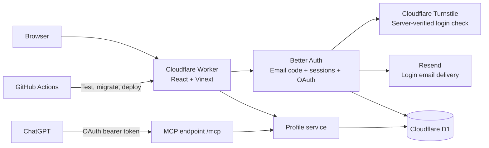

# Architecture

wya.im is one Cloudflare Worker with two ways to manage a profile: the browser dashboard and ChatGPT. Both use the same account ID, validation, profile storage, and revision history.

These boxes represent responsibilities within one Worker, except Turnstile, Resend, D1, GitHub Actions, and ChatGPT. There is no separate API server or AI API bill for the account-linking feature.

| Part | Implementation | Purpose |
| --- | --- | --- |
| Domain registration | Namecheap | Keeps ownership and renewal of `wya.im` |
| DNS, TLS, hosting | Cloudflare | Domain routing, HTTPS, Worker, static assets |
| UI | React, TypeScript, Vinext, Vite, Tailwind | Landing page, profiles, dashboard, sign-in and consent |
| Database | Cloudflare D1 (SQLite) | Spaces, current usernames and fallback redirects, revisions, users, sessions, hashed codes, OAuth grants and limits |
| Authentication | Better Auth 1.7.10 | Passwordless email sign-in and secure browser cookies |
| Login abuse protection | Cloudflare Turnstile and D1 limits | Verifies hostname/action, serializes code requests, reserves existing-account email capacity |
| Email delivery | Resend Free | Delivers codes from `hello@wya.im`; no marketing emails |
| ChatGPT authorization | Better Auth OAuth/MCP plugins | OAuth authorization code + S256 PKCE, consent, scoped tokens |
| Business rules | Zod and shared `lib/service.ts` | Safe URLs, social usernames, owner isolation, optimistic version checks |
| Deployment | GitHub Actions and Wrangler | Test, build, migrate D1, sync secrets, deploy |

## Sign-in and ChatGPT linking

1. The user enters an email at `/sign-in` and completes Turnstile. The Worker validates the token, hostname, and `login` action server-side, acquires a short recipient lease, and checks eligibility before creating a code. An unexpired delivered code stays valid: resends return `OTP_ACTIVE`, and the form lets the user enter that existing code. Better Auth stores a six-digit code hash in D1 and sends through Resend. Delivery errors return an error and remove the undelivered challenge; no false success response.
2. A code expires after five minutes, allows three verification attempts, and can be used once. Persistent IP and recipient limits plus global sending caps restrict abuse. Successful verification creates the internal user and an HttpOnly session cookie. Production cookies are Secure and SameSite=Lax.
3. The dashboard uses that session to resolve the owner ID. Mutation payloads never choose their owner.
4. ChatGPT connects to `https://wya.im/mcp`, discovers the OAuth server, registers an OAuth client, and starts authorization with PKCE. The user signs in with the same email and reviews `/consent`.
5. ChatGPT receives a token bound to `/mcp`. The Worker verifies its signature, issuer, audience, expiry, scopes, and current consent before calling the profile service. Browser cookies cannot authorize MCP calls.
6. `/connections` lets the user disconnect an app. This removes consent and its durable access/refresh tokens; MCP also checks live consent rather than relying on JWT expiry alone.

Scopes are `profile:read`, `profile:write`, and `offline_access`. Access tokens last five minutes; refresh tokens last 30 days. Dynamic client registration supports ChatGPT without a shared client secret. Client names supplied through registration are not verified identities; the consent page also shows the redirect destination. General client/resource administration and machine-to-machine grants are disabled.

The code reserves at most 90 login emails per UTC day and 2,500 per month, with one reservation per recipient per minute and five per hour. Unverified/new accounts can use at most 30 per day and 750 per month, leaving capacity for existing verified accounts. IP checks allow three requests per minute and 15 per day before challenge verification. Failed delivery attempts still consume a reservation. These caps protect the budget and can temporarily stop sign-in if exhausted. Resend handles delivery; Better Auth handles identity. Codes, keys, and email message bodies are never logged by the application.

## Storage and updates

Application tables are defined in `db/schema.ts`. Auth tables are managed by Better Auth and the committed additive migration `drizzle/0001_auth.sql`. Keep the two sets of tables separate when generating future migrations. `scripts/generate-auth-migration.mjs` documents how the initial auth SQL was generated; do not overwrite an applied migration when upgrading auth.

- `GET /alex` renders visible links.
- `GET /alex/github` returns a noncached 302; hidden links return 404. Wya homepage and profile URLs are allowed as destinations. Internal short-link chains are resolved from stored data to their final destination, without fetching external URLs. Visible link saves reject known cycles, including aliases; every visit checks again to stop cycles introduced by later edits, restored history, renames, or concurrent writes. Resolution allows up to 10 stored links and returns 508 for a cycle or a longer chain. External sites' redirects are outside this check.
- Dashboard edits and MCP tools call the same service. Changed updates record a previous revision and check the expected version; unchanged saves preserve the version and create no history. Stale writes return a conflict.
- Instagram and GitHub usernames expand into URLs. They are not identity verification or social sign-in.

Links have separate display names (`label`) and short URL segments (`slug`). Dashboard edits send `originalSlug` with `upsert_link` to identify the existing link when changing its slug. The shared service replaces it in place, preserves an omitted icon, rejects a missing original or a conflicting slug, and applies the same version and redirect-loop checks. A slug change retires the old path unless it is explicitly included in the item’s aliases; the editor explains both cases before saving. Content history can restore the prior slug. Existing API clients that omit `originalSlug` retain upsert-by-slug behavior.

The Sites preview remains a separate deployment and database. It still uses its trusted Sites authentication gateway. The standalone Worker strips all caller-supplied Sites identity headers and only uses independent sessions/OAuth. Existing Sites profiles are not automatically attached to email accounts; any migration needs a verified identity mapping.

## Link sections

Spaces optionally store ordered `sections` (`id`, `title`) in their existing JSON content; links refer to a section with `sectionId`. Profiles without sections keep their flat list. Unassigned links form an untitled group whose `ungroupedPosition` can place it before, between, or after sections. Existing profiles default to position 0 (first). The dashboard, public profile and MCP use the same ordering. Empty sections (including sections containing only hidden links) have no public heading. Titles render as plain text.

The dashboard keeps layout drafts per space, including titles, membership, section order and link order. Drag handles, arrow buttons and section menus modify the draft and preview. **Save layout** calls `set_tabs` once for the whole space; **Discard** restores the saved layout. Removing a section moves its links to the untitled group. Link edits and slug renames reconcile with pending drafts. Failed saves preserve drafts, and version conflicts require a fresh save against the refreshed version.

Pointer dragging uses a stable editor capture and a six-pixel activation threshold. Geometry-based insertion targets include the gaps between sections and empty groups. A floating item summary and insertion line show the destination; viewport-edge scrolling continues while the pointer is held. Escape, pointer cancellation and window blur cancel the move; dropping outside the editor leaves the draft unchanged. Repositioning animates after a successful drop unless reduced motion is requested. Section moves retain their links, and keyboard arrows and section menus remain available. Dragging never calls the account API.

`set_layout` is shared by the account API and MCP. For profiles with multiple tabs it requires `tabId` and applies only within that tab; use `set_tabs` to move items across tabs. It accepts `ungrouped` slugs, optional `ungroupedPosition` (0 through the section count; omission preserves the current position), and ordered `sections` with `id`, `title`, and `slugs`; every existing link in the selected tab, including hidden links, must occur exactly once. The service rejects duplicate IDs, unknown/missing/duplicate slugs, more than 20 sections, and titles outside 1–60 characters. Layout updates use existing ownership/version checks and create one history revision. Existing `reorder_links` calls preserve section membership and section order. Restoring old history can remove sections. No database migration or new service is needed.

## Optional profile tabs

Each space has one implicit Home tab until a layout is saved. Legacy `sections`, `sectionId` and `ungroupedPosition` retain their appearance without a migration. New layouts store `tabs` and `defaultTabId` in the existing JSON snapshot. Each tab has a stable ID, title, URL slug, ordered sections, ungrouped item slugs and its own ungrouped position. Items remain in the space-wide `links` array; tab layouts refer to primary slugs. Applying a tab layout synchronizes item order and `sectionId`, and retires the legacy top-level section fields. Renaming/deleting items updates tab references. URLs and aliases remain unique across the entire space, independent of tabs.

Limits are 1–5 tabs per space, 20 sections total and the existing 100-item cap. Tab titles are 1–30 characters; URL names use lowercase letters/numbers joined by hyphens, up to 40 characters. Tab IDs, tab URL names and section IDs must be unique in their respective namespaces. `set_tabs` requires every item, including hidden items, exactly once and an existing default tab. Ownership, optimistic version checks and revision history cover the entire layout. Restoring an older revision can remove tabs; profile pictures remain outside revision history.

The editor keeps one draft per space across all tabs. Changing tabs, names, default selection, ordering, section placement or item placement does not save. Removing a tab requires choosing a destination, clicking Remove tab, and confirming a dialog that names both tabs. Selecting a destination alone does not change the draft. Cancellation keeps the layout unchanged; confirmation preserves all sections and items and only updates the draft. New tabs must be saved before creating new items in them; existing items can be moved into them in the draft. Dragging remains scoped to the active tab; menus move items or entire sections between tabs. Saving publishes all tabs atomically. Discard resets the whole layout, and failed requests retain the draft.

Public profiles share one identity header and use `/{handle}?tab={slug}` for navigation; omitting or supplying an unknown tab selects the configured default. A single tab hides navigation. Navigation uses ordinary links with progressive Next navigation, supports browser history, and scrolls horizontally on narrow screens. Empty tabs display an empty state; empty sections remain hidden. Public reads strip hidden item slugs from tab membership as well as omitting their content. Short URLs stay `/{handle}/{slug}`. Previous-handle redirects preserve the tab query.

MCP `get_profile` returns a normalized `layout`, including the implicit Home tab for legacy data. `set_tabs` edits the full hierarchy, `set_layout` edits one existing tab, and item upserts accept optional `tabId` (new items default to the default tab; edits retain placement when omitted). `reorder_links` retains tab and section membership.

## Email, aliases and project tiles

Email uses the `email` preset and a normalized `mailto:` URL with one recipient plus optional subject/body. Other URL presets still require HTTP(S). Arbitrary mail headers, duplicate query keys, subject line breaks, embedded credentials and executable URL schemes are rejected. Public email buttons use mailto directly; short URLs and aliases resolve to the same mailto destination. Mail-client availability belongs to the visitor’s device; no Resend message is sent.

Link items gain a stable `id` on creation or first edit and optional `aliases` (up to 10). Aliases are stored on the item, never as redirects to another slug; canonical slugs and aliases share a unique namespace per space. Renames retain the ID, aliases, section and position. Old primary URLs are retained only when explicitly added as aliases. Hidden/deleted items disable every alias. Resolver cycle tracking uses the item identity, so alternate aliases cannot evade loop detection. `createOnly` lets the dashboard reject accidental replacement of an existing item; older upsert-by-slug clients remain supported.

Projects render as compact list tiles with an optional square thumbnail, description and inline action links. Projects are structured items (`kind: project`) in the same JSON content: description, optional HTTPS cover URL and 1–3 labeled destinations. Their first button is mirrored as the short URL destination. The `upsert_project` action shares ownership, version, collision, loop, history and layout rules with links; ordinary link updates cannot overwrite project cards. Projects default to hidden on creation, while omitted visibility preserves it on edits. Public reads omit hidden cards. Project fragments use stable item IDs. Limits: 12 projects per space, 100 total items, 60-character titles, 800-character descriptions, and 30-character button labels.

Covers load directly in the browser with no referrer and a text-card fallback on failure. There is no server-side metadata/image fetching, image upload, or new storage binding. These external image URLs are part of text revisions and can be restored; their image content is controlled by the host. Future R2 project uploads require broader ownership/reference and cleanup handling. See `docs/ideas.md` for carousel planning; carousel rendering is not implemented.

## Operations and future work

The custom domain is attached in Cloudflare's dashboard. CI has no DNS permissions and preserves that attachment. Workers.dev and preview URLs stay disabled. Runtime secrets are Cloudflare Worker secrets, mirrored in GitHub Actions for deployment; local copies are ignored and permission-restricted.

Generated profile layouts should reuse structured profile data. Arbitrary hosted HTML would need an isolated rendering boundary. R2 stores current profile pictures; Redis is not required.

## Link presets and icons

`lib/link-options.ts` defines the shared preset and icon catalog. The dashboard, public cards, Zod validation, and MCP discovery use that catalog. Presets provide a label, suggested slug, destination hint, and default icon; they do not restrict the destination to a particular host. GitHub and Instagram accept usernames, while other presets require a full HTTP(S) URL.

Links can store an optional `icon` ID independently of `platform` in the existing profile JSON, so no database migration is needed. Old links use the preset default. An omitted icon in `upsert_link` preserves an existing override; `null` clears it. History snapshots retain icons with the rest of the link data. Icon SVGs are bundled with the app; there are no third-party icon requests or uploaded SVGs. The curated library includes 60 Lucide symbols and 29 Simple Icons brand logos, using explicit imports. Keep existing IDs stable when adding icons. The dashboard opens a Radix dialog with a lazily loaded browser: keyword search, five categories, quick picks, and batches of 36 results keep the form compact as the library grows. Selecting an icon updates the draft; saving the link persists it.

## Multiple spaces and usernames

An account owns up to five spaces. `spaces.id` is stable across username changes; `user_id` is always resolved from the verified session or OAuth token. Each space has independent profile JSON, links, version, and `space_revisions`. Database triggers enforce the five-space limit and exclusive current usernames even under concurrent requests.

`space_handles` maps each current username and at most one previous username directly to a space ID. Only current usernames are exclusive. Renaming makes the old username available immediately and retains it as a fallback redirect until anyone claims it or the space renames again. A second rename removes the earlier fallback. Creation and renaming can both claim a fallback, including from another space on the same account. Database triggers transfer the mapping atomically; concurrent claims have only one winner. Claims never transfer profile content, links, history, account access, or the stable space ID. Public profile aliases redirect temporarily to the current username; short-link aliases redirect to the current username and slug before the usual noncached external redirect. Hidden/deleted links remain unavailable through aliases. After a claim, all paths under that username belong to the new owner; a missing slug returns 404 rather than falling through to the previous owner. Restoring content history does not roll back the username.

The dashboard stores the selected space ID in its URL. The account API and MCP mutation schemas accept `spaceId`; the service checks ownership on every read/write. Omission remains compatible for accounts with exactly one space, but is rejected when multiple spaces exist. ChatGPT can call `list_spaces` to choose a space, then `get_profile` and the existing editing tools, or `rename_space`. Existing OAuth scopes cover the account’s spaces; consent copy makes this explicit.

Migration `0002_spaces.sql` copies existing profiles and history into the new tables without changing usernames or versions. Legacy tables remain intact. Bridge triggers copy writes from the prior Worker during the migration/deployment interval, and reject legacy writes once a newer space version exists. New code writes only the space tables. No space deletion is exposed. Migration `0003_reclaimable_handles.sql` replaces the reservation triggers and prunes historical aliases to the immediately previous username, using the latest rename revision rather than original handle creation time.

## Bio mentions and links

Bios remain plain text with a 280-character limit, including in history and MCP actions. `lib/bio.ts` parses `@handle` into a Wya profile link, platform-prefixed usernames into external profile links, and full HTTP(S) URLs into direct links. Supported prefixes are `github:`, `instagram:`, `linkedin:`, `youtube:`, `tiktok:`, `x:`, `bluesky:`, `telegram:`, and `twitch:`. Other destinations can use a full URL. Wya mentions follow the current username mapping: a fallback while unclaimed, the new owner after a claim, or 404 after an earlier fallback is removed.

The shared `BioText` renderer produces escaped React text and anchors, never user HTML. It leaves email addresses and invalid mentions alone, rejects credential-bearing URLs, and separates sentence punctuation from links. There are no outbound lookups, identity claims, mention notifications, or directory searches. Links open in a new tab with `noopener noreferrer ugc`.

The dashboard and new-space form offer an Insert mention helper, character count, and draft preview. Insertion replaces the textarea selection and only persists when the parent form is saved. MCP create/update schemas describe the same plain-text notation. This feature needs no schema migration or new service.

## Space pictures

Each space has one optional `spaces.picture_key`, stored outside the JSON used for revisions. Picture updates increment the space version but create no history entry. Restoring a revision preserves the current picture. The dashboard keeps unsaved profile text when a picture is saved.

The browser accepts JPEG, PNG, and WebP up to 5 MiB (shown as 5 MB), applies orientation, lets the user crop/pan/zoom/rotate, and exports a 512×512 WebP at quality 0.85 (PNG fallback if WebP encoding is unavailable). The original never leaves the browser. Canvas export strips original file metadata. Files the browser cannot decode are rejected; there is no HEIC, SVG, or animation support in the editor.

`PUT /api/pictures?spaceId=…&expectedVersion=…` accepts the optimized bytes, with a signed-in session and same-origin check. The Worker checks ownership/version before reading, counts streamed bytes independently of Content-Length, and checks the raster MIME/signature. It does not decode, resize, or optimize images. Clients bypassing the editor can upload an unoptimized raster within 5 MiB; dimensions and compression are not server-enforced.

A private R2 bucket `wya-im-pictures` is bound as `PICTURES`. No public bucket, S3 credentials, Cloudflare Images, or image-processing service is needed. `GET /api/pictures/:key` exposes only an object currently referenced by a space. It uses a random key, fixed raster content type, nosniff, and revalidation/ETags. New uploads get new keys; old URLs return 404 after removal/replacement. Browser copies already downloaded cannot be recalled.

Upload order: reserve an object key in `picture_objects`, write R2, compare-and-swap the space version/key in D1, then delete the prior object. Failed deletion is retried by an hourly sweep of unreferenced objects older than an hour (up to 100 per invocation). This also removes abandoned uploads. An ambiguous D1 failure does not eagerly delete the new object because the update may have committed. The ledger is operational cleanup metadata, not recoverable photo history.

MCP `get_profile` returns the current picture URL and an authenticated dashboard editing link. `copy_profile_picture` copies bytes into an independent object between two owned spaces; `remove_profile_picture` removes it. Both require explicit space IDs and the current version. New pictures must be uploaded in the dashboard; conversation attachments are not fetched by the server.

## Request and resource limits

Account/MCP JSON is limited to 16,000 streamed bytes before decoding. Auth bodies (including OAuth forms) are limited to 32,000 bytes before the auth library parses them. Missing or inaccurate Content-Length cannot bypass these bounds; over-limit streams are cancelled. Pictures retain their separate 5 MiB streaming cap.

All profile writes, including unchanged saves, share a D1-backed account budget with picture upload/copy/removal: 30 attempts per minute and 300 per UTC day. Renames additionally allow ten attempts per UTC day. These limits apply across dashboard and MCP, across all spaces, and across Worker instances. They do not change ownership checks or the chosen immediate-reclaim username policy.

Migration `0005_security_limits.sql` creates the shared counters and recipient leases. It retains the latest **50 content revisions per space**, pruning older revisions during migration and after subsequent inserts. Old revisions beyond this window cannot be restored. Current content, usernames, and pictures are unaffected by pruning. Legacy bridge tables remain intact. Hourly maintenance removes expired counters/leases alongside picture cleanup.

Standalone sign-in, consent, dashboard, connections and auth API responses forbid framing (`frame-ancestors 'none'` and X-Frame-Options DENY) and use private no-store caching. Picture sandbox headers are preserved. GitHub Actions are pinned to immutable commits.

Turnstile and quotas reduce automated abuse; finite free-tier mail capacity is not an availability guarantee against a distributed attacker with valid challenges and verified accounts. Monitor quota consumption and delivery failures. Never log codes, tokens, or recipient addresses when doing so.

## Interests and game catalog

Games are `kind: "interest"` items in the existing profile JSON, with `interest.type: "game"`. The type registry in `lib/interests.ts` owns labels, icons and status wording. The shared editor, compact tile, cover fallback and catalog-result shape can serve future anime, movie, series and music types. Only games are currently enabled; future types still need validation, appropriate providers and their access terms.

An interest stores its personal note, optional status, favorite flag, hosted HTTPS cover, optional outgoing URL, and optional catalog reference. It retains the same stable ID, global slug/alias namespace, 100-item cap, tabs/sections, ordering, ownership, optimistic version checks and revision history as other items. New interests start hidden. No image upload or R2 lifecycle is added: these covers are external URLs and historical URLs can eventually become unavailable.

`GET /api/catalog` and the MCP `search_catalog` tool call the same authenticated catalog service. `lib/game-catalog.ts` adapts IGDB results to `CatalogItem`, handles server-side Twitch tokens, escapes search syntax, times out upstream requests and caches bounded results. Only fixed Twitch/IGDB endpoints are fetched. Secrets never reach the browser. The dashboard game flow is search, select, and add; titles and covers come from the catalog with no title, description, cover, or tracking fields to fill in. Optional buttons reuse the project button editor and renderer: up to three named HTTP(S) links, with the first becoming the short URL destination. Omitted buttons are preserved; an empty list removes them. The dashboard restores the catalog destination after removing the last custom button. New games are visible when added. Replacing a game keeps its existing short URL, aliases, and visibility. Saving uses the same `upsert_interest` action through the dashboard or MCP. Stored metadata is a user-editable snapshot, not verified play activity. No API call is needed to render saved items.

A game without an outgoing URL has a plain title; its short URL and aliases resolve to the containing profile tab and stable item fragment. Hidden/deleted items remain unavailable. Games with destinations participate in the existing redirect-loop checks. Search and selection alone never publish an item.
