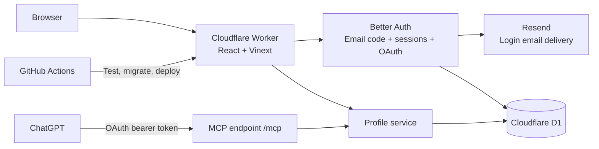

# Architecture

wya.im is one Cloudflare Worker with two ways to manage a profile: the browser dashboard and ChatGPT. Both use the same account ID, validation, profile storage, and revision history.

These boxes represent responsibilities within one Worker, except Resend, D1, GitHub Actions, and ChatGPT. There is no separate API server or AI API bill for the account-linking feature.

| Part | Implementation | Purpose |
| --- | --- | --- |
| Domain registration | Namecheap | Keeps ownership and renewal of `wya.im` |
| DNS, TLS, hosting | Cloudflare | Domain routing, HTTPS, Worker, static assets |
| UI | React, TypeScript, Vinext, Vite, Tailwind | Landing page, profiles, dashboard, sign-in and consent |
| Database | Cloudflare D1 (SQLite) | Spaces, reserved usernames, revisions, users, sessions, hashed codes, OAuth grants and limits |
| Authentication | Better Auth 1.7.10 | Passwordless email sign-in and secure browser cookies |
| Email delivery | Resend Free | Delivers codes from `hello@wya.im`; no marketing emails |
| ChatGPT authorization | Better Auth OAuth/MCP plugins | OAuth authorization code + S256 PKCE, consent, scoped tokens |
| Business rules | Zod and shared `lib/service.ts` | Safe URLs, social usernames, owner isolation, optimistic version checks |
| Deployment | GitHub Actions and Wrangler | Test, build, migrate D1, sync secrets, deploy |

## Sign-in and ChatGPT linking

1. The user enters an email at `/sign-in`. Better Auth creates a six-digit code, stores a hash in D1, and sends the code through Resend.
2. A code expires after five minutes, allows three verification attempts, and can be used once. Persistent IP and recipient limits plus global sending caps restrict abuse. Successful verification creates the internal user and an HttpOnly session cookie. Production cookies are Secure and SameSite=Lax.
3. The dashboard uses that session to resolve the owner ID. Mutation payloads never choose their owner.
4. ChatGPT connects to `https://wya.im/mcp`, discovers the OAuth server, registers an OAuth client, and starts authorization with PKCE. The user signs in with the same email and reviews `/consent`.
5. ChatGPT receives a token bound to `/mcp`. The Worker verifies its signature, issuer, audience, expiry, scopes, and current consent before calling the profile service. Browser cookies cannot authorize MCP calls.
6. `/connections` lets the user disconnect an app. This removes consent and its durable access/refresh tokens; MCP also checks live consent rather than relying on JWT expiry alone.

Scopes are `profile:read`, `profile:write`, and `offline_access`. Access tokens last five minutes; refresh tokens last 30 days. Dynamic client registration supports ChatGPT without a shared client secret. Client names supplied through registration are not verified identities; the consent page also shows the redirect destination. General client/resource administration and machine-to-machine grants are disabled.

The code reserves at most 90 login emails per UTC day and 2,500 per month, below Resend's free-tier sending allowance, with one request per recipient per minute and five per hour. Failed delivery attempts still consume a reservation. These caps protect the budget and can temporarily stop sign-in if exhausted. Resend handles delivery; Better Auth handles identity. Codes, keys, and email message bodies are never logged by the application.

## Storage and updates

Application tables are defined in `db/schema.ts`. Auth tables are managed by Better Auth and the committed additive migration `drizzle/0001_auth.sql`. Keep the two sets of tables separate when generating future migrations. `scripts/generate-auth-migration.mjs` documents how the initial auth SQL was generated; do not overwrite an applied migration when upgrading auth.

- `GET /alex` renders visible links.
- `GET /alex/github` returns a noncached 302 to the saved destination; hidden links return 404.
- Dashboard edits and MCP tools call the same service. Every update records a previous revision and checks the expected version. Stale writes return a conflict.
- Instagram and GitHub usernames expand into URLs. They are not identity verification or social sign-in.

The Sites preview remains a separate deployment and database. It still uses its trusted Sites authentication gateway. The standalone Worker strips all caller-supplied Sites identity headers and only uses independent sessions/OAuth. Existing Sites profiles are not automatically attached to email accounts; any migration needs a verified identity mapping.

## Operations and future work

The custom domain is attached in Cloudflare's dashboard. CI has no DNS permissions and preserves that attachment. Workers.dev and preview URLs stay disabled. Runtime secrets are Cloudflare Worker secrets, mirrored in GitHub Actions for deployment; local copies are ignored and permission-restricted.

Generated profile layouts should reuse structured profile data. Arbitrary hosted HTML would need an isolated rendering boundary. R2 can store future uploads or exports, but this version needs neither R2 nor Redis.

## Link presets and icons

`lib/link-options.ts` defines the shared preset and icon catalog. The dashboard, public cards, Zod validation, and MCP discovery use that catalog. Presets provide a label, suggested slug, destination hint, and default icon; they do not restrict the destination to a particular host. GitHub and Instagram accept usernames, while other presets require a full HTTP(S) URL.

Links can store an optional `icon` ID independently of `platform` in the existing profile JSON, so no database migration is needed. Old links use the preset default. An omitted icon in `upsert_link` preserves an existing override; `null` clears it. History snapshots retain icons with the rest of the link data. Icon SVGs are bundled with the app; there are no third-party icon requests or uploaded SVGs. The curated library includes 60 Lucide symbols and 29 Simple Icons brand logos, using explicit imports. Keep existing IDs stable when adding icons. The dashboard opens a Radix dialog with a lazily loaded browser: keyword search, five categories, quick picks, and batches of 36 results keep the form compact as the library grows. Selecting an icon updates the draft; saving the link persists it.

## Multiple spaces and usernames

An account owns up to five spaces. `spaces.id` is stable across username changes; `user_id` is always resolved from the verified session or OAuth token. Each space has independent profile JSON, links, version, and `space_revisions`. Database triggers enforce the five-space limit and global username reservation even under concurrent requests.

`space_handles` maps every current and former username directly to a space ID. Renaming keeps the old address reserved, allows reclaiming a former address only for that same space, and creates a history entry. Public profile aliases redirect temporarily to the current username; short-link aliases redirect to the current username and slug before the usual noncached external redirect. Hidden/deleted links remain unavailable through aliases. Restoring content history does not roll back the username.

The dashboard stores the selected space ID in its URL. The account API and MCP mutation schemas accept `spaceId`; the service checks ownership on every read/write. Omission remains compatible for accounts with exactly one space, but is rejected when multiple spaces exist. ChatGPT can call `list_spaces` to choose a space, then `get_profile` and the existing editing tools, or `rename_space`. Existing OAuth scopes cover the account’s spaces; consent copy makes this explicit.

Migration `0002_spaces.sql` copies existing profiles and history into the new tables without changing usernames or versions. Legacy tables remain intact. Bridge triggers copy writes from the prior Worker during the migration/deployment interval, and reject legacy writes once a newer space version exists. New code writes only the space tables. No space deletion or username release is exposed.

## Bio mentions and links

Bios remain plain text with a 280-character limit, including in history and MCP actions. `lib/bio.ts` parses `@handle` into a Wya profile link, platform-prefixed usernames into external profile links, and full HTTP(S) URLs into direct links. Supported prefixes are `github:`, `instagram:`, `linkedin:`, `youtube:`, `tiktok:`, `x:`, `bluesky:`, `telegram:`, and `twitch:`. Other destinations can use a full URL. Wya mentions follow existing username aliases after a rename.

The shared `BioText` renderer produces escaped React text and anchors, never user HTML. It leaves email addresses and invalid mentions alone, rejects credential-bearing URLs, and separates sentence punctuation from links. There are no outbound lookups, identity claims, mention notifications, or directory searches. Links open in a new tab with `noopener noreferrer ugc`.

The dashboard and new-space form offer an Insert mention helper, character count, and draft preview. Insertion replaces the textarea selection and only persists when the parent form is saved. MCP create/update schemas describe the same plain-text notation. This feature needs no schema migration or new service.
