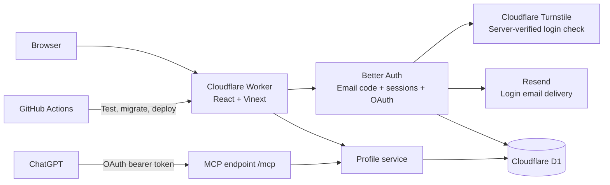

# Architecture

wya.im is one Cloudflare Worker with two ways to manage a profile: the browser dashboard and ChatGPT. Both use the same account ID, validation, profile storage, and revision history.

These boxes represent responsibilities within one Worker, except Turnstile, Resend, D1, GitHub Actions, and ChatGPT. There is no separate API server or AI API bill for the account-linking feature.

| Part | Implementation | Purpose |
| --- | --- | --- |
| Domain registration | Namecheap | Keeps ownership and renewal of `wya.im` |
| DNS, TLS, hosting | Cloudflare | Domain routing, HTTPS, Worker, static assets |
| UI | React, TypeScript, Vinext, Vite, Tailwind | Landing page, profiles, dashboard, sign-in and consent |
| Database | Cloudflare D1 (SQLite) | Spaces, current usernames and fallback redirects, revisions, users, sessions, hashed codes, OAuth grants and limits |
| Authentication | Better Auth 1.7.10 | Passwordless email sign-in and secure browser cookies |
| Login abuse protection | Cloudflare Turnstile and D1 limits | Verifies hostname/action, serializes code requests, reserves existing-account email capacity |
| Email delivery | Resend Free | Delivers codes from `hello@wya.im`; no marketing emails |
| ChatGPT authorization | Better Auth OAuth/MCP plugins | OAuth authorization code + S256 PKCE, consent, scoped tokens |
| Business rules | Zod and shared `lib/service.ts` | Safe URLs, social usernames, owner isolation, optimistic version checks |
| Deployment | GitHub Actions and Wrangler | Test, build, migrate D1, sync secrets, deploy |

## Experimental desktop

The authenticated `/experimental-dashboard/{section}?space={id}` route renders the same `DesktopProfile` as public desktop pages and embedded previews. There is no nested preview desktop. Owners get edit controls on the profile and items, plus management apps in Start. These controls inject existing editors and workspace services into the shared window stack; the public component does not import dashboard editors or grant content writes. Make it yours saves the owner's color and typography through partial profile updates; visitor choices stay local. The OS profile form omits the appearance pickers and preserves unfinished name/bio edits when appearance changes. View as visitor uses the same visibility projection as the public service, hiding private tabs, items and collection children. It displays saved content; unsaved layout drafts stay in the owner view.

`app-registry.tsx` defines each application's identity, window presentation, renderer and optional file/page resource. The desktop shell uses this registry for shortcuts, launchers and windows. `lib/desktop-entries.ts` gives files, folders and page references a common identity and explicit move, rename, copy and pin capabilities. Its commands delegate to existing file services; they do not create a second persistence or permission layer.

`use-desktop-session.ts` restores open and minimized windows, stacking order, maximized state and positions from a validated, versioned localStorage record per space and owner/visitor mode. Restoration waits for current metadata and reloads open documents through the authorized endpoint; inaccessible or deleted entries are omitted. Saved records contain window and taskbar metadata only, never file contents, tokens or editor drafts. Taskbar pins are independent of running windows and can reference apps, tabs, files, or folders. Closing removes an unpinned entry; minimizing keeps its running indicator; closed pins remain launchable. Pins stay ordered before other running apps, survive Reset desktop, and are isolated by space and owner/visitor mode. Folder pins open their location in the shared Files window. Context menus on the desktop, Start menu, Files, and taskbar expose pin/unpin through right-click, long press, or Shift+F10. Metadata errors do not erase saved pins. Restored positions are clamped to the viewport before display, and mobile stacking does not overwrite desktop coordinates. Explicit navigation can still open its requested app. Empty desktops are remembered; Reset desktop clears window placement. Storage failures fall back to an ordinary working desktop. Embedded previews do not restore or save sessions. This is device-local continuity, not cross-device synchronization or offline editing.

The standard `/dashboard` remains available. Authentication, ownership checks, autosave and APIs are unchanged. Owner forms stay mounted when minimized and when viewing as a visitor; entry autosave flushes before leaving an editor or switching spaces. A new space starts a fresh desktop session. On mobile, only the frontmost window is shown. The experimental route is reserved as a handle, excluded from indexing and protected like the standard dashboard. Public requests still receive public data only; entering owner mode requires the authenticated experimental route. Shortcut order is stored in profile JSON; document storage and organization use the separate tables described below.

## Desktop files

The shared desktop includes Files and Text Editor. `lib/space-file-service.ts` stores documents in `space_files` (migration `0009_space_files.sql`), separately from profile JSON and revision history. Each space supports up to 30 `.md` or `.txt` files, limited to 64 KiB of UTF-8 text each, plus 30 folders nested up to five levels. Migration `0010_space_file_folders.sql` adds `space_file_folders` and nullable file folder IDs; existing files remain at the root. File IDs and desktop shortcuts stay stable when renamed or moved. File names are unique within their containing folder, ignoring case; folder names are unique among sibling folders.

Migration `0012_desktop_folder.sql` gives every existing and newly created space a protected system Desktop folder. Files, page references and ordinary folders placed directly inside it appear on the desktop; moving them out removes their icons. Subfolder contents stay inside their folder. Private drafts appear only to the owner. The Desktop directory also lists the built-in app shortcuts. It cannot be renamed, moved or deleted and does not consume the user folder quota or nesting depth. Public directories retain Desktop even when empty, but still omit private documents and draft-only user folders.

Desktop membership replaces the old independent pin fields. The migration moves previously pinned files and pages into Desktop while preserving IDs and content, handles filename collisions, and preserves existing user folders named Desktop under an available numbered name. Legacy pin API actions now move an item to Desktop or the file root; the returned `pinned` flag is derived from location. This migration and the folder-aware application must be released together because the redundant database pin columns are removed. Moving an item does not publish it, and unpublishing keeps its owner-side location.

The Files app provides Back/Forward/Up navigation, breadcrumbs, selection, folder creation and renaming, and shared actions in each entry's right-click and three-dot menus. Its last folder is remembered on this device per space and access mode. Double-click or Enter opens an entry; the Open toolbar action also supports touch. Owners can cut and paste files, pages and folders, or copy text files into new private drafts. Copy flushes an open editor first and retains only its name and content. The in-app clipboard is temporary and does not copy publication state or desktop pins. F2 and Ctrl/Cmd X/C/V provide keyboard equivalents and do not intercept text editing.

Owners can also drag documents and folders onto a folder or breadcrumb; folder moves reject cycles and excessive nesting in the SQL write. Folder deletion is restricted to empty folders in the SQL write itself. Folder writes and file destinations are checked against the authenticated space. `lib/space-folder-service.ts` handles folder persistence after the file service authorizes the owner. Moving or renaming an open file flushes pending edits and uses the editor's current version. Moves preserve its publication snapshot. Folder organization changes apply immediately to public content. Visitors receive only user folders that are ancestors of published text files or visible Wya pages, so empty and draft-only user folders remain private. Dropping `.md` and `.txt` uploads into Files creates private drafts in the current folder.

Existing tabs appear in the OS under their tab title, without a filename extension. Opening one dispatches the existing tab content window; it does not parse uploaded code or duplicate profile content. `lib/space-page-file-service.ts` projects tabs into directory metadata, and `space_page_files` stores only folder placement with optimistic versions. Tab editing, visibility, existing URLs and Classic rendering keep their current behavior. Tabs do not count toward the text-file quota. Removing a tab removes it from the directory, and stale metadata cannot prevent deleting an otherwise empty folder.

Desktop shortcuts support drag reordering and equivalent menu actions. Owner arrangements save through `update_profile.desktopOrder`; visitor arrangements stay in component state. Owners can drag a file, page or folder from Files onto the desktop to move it into Desktop, or onto a desktop folder icon to move it inside that folder. Opening a folder icon navigates the shared Files app. Drag payloads are scoped to a space, and all persisted moves still pass the authenticated API. Desktop icons have no action buttons: right-click, touch long press, or ContextMenu/Shift+F10 opens the same menu. Radix handles long-press timing and cancellation; the release click is suppressed so opening the menu does not also launch the app. Files rows retain their three-dot menus.

Desktop and Explorer dragging use Atlassian's Pragmatic Drag and Drop through `use-desktop-drag.ts`. The adapter owns source/target registration, cleanup, nested-target dispatch and isolated native drag previews. Window titlebar movement remains a separate pointer/keyboard interaction. Native file uploads keep their existing validation. ZenFS is not introduced: the current server-owned documents and public snapshots do not need a Node-compatible filesystem or an additional browser storage engine.

`/api/files` requires the signed-in space owner, validates same-origin writes, applies a per-account write limit, and checks the individual file version. Autosave updates the private draft. Publish copies the current name and content into a public snapshot; later edits remain private until published again. Unpublish removes the snapshot while retaining the file's location for the owner. Delete removes both copies. File lists contain metadata only; content is loaded when opened. Pending saves flush before closing a document, switching spaces, or entering visitor preview. Conflicts keep local edits available to download instead of overwriting a newer version.

`/api/public-files?handle=...` returns only published text snapshots and visible page references, including when requested by a signed-in owner. It does not share the private read path. Custom domains allow this endpoint only for their own handle and continue to block the owner API. Responses use `no-store` so unpublished files are not served from an HTTP cache. Already downloaded or open copies cannot be recalled.

Markdown uses `react-markdown` without raw HTML or executable plugins. Links are limited to explicit HTTP, HTTPS and mailto URLs; image references render alt text rather than making third-party image requests. Visitors can read, download, or edit a temporary copy without making writes. Files and editors share the existing window stack, support mobile layouts, and include English and Brazilian Portuguese UI copy. The classic dashboard has no file manager yet. Files are not currently exposed through MCP.

## Sign-in and ChatGPT linking

1. The user enters an email at `/sign-in` and completes Turnstile. The Worker validates the token, hostname, and `login` action server-side, acquires a short recipient lease, and checks eligibility before creating a code. An unexpired delivered code stays valid: resends return `OTP_ACTIVE`, and the form lets the user enter that existing code. Better Auth stores a six-digit code hash in D1 and sends through Resend. Delivery errors return an error and remove the undelivered challenge; no false success response.
2. A code expires after five minutes, allows three verification attempts, and can be used once. Persistent IP and recipient limits plus global sending caps restrict abuse. Successful verification creates the internal user and an HttpOnly session cookie. Production cookies are Secure and SameSite=Lax.
3. The dashboard uses that session to resolve the owner ID. Mutation payloads never choose their owner.
4. ChatGPT connects to `https://wya.im/mcp`, discovers the OAuth server, registers an OAuth client, and starts authorization with PKCE. The user signs in with the same email and reviews `/consent`.
5. ChatGPT receives a token bound to `/mcp`. The Worker verifies its signature, issuer, audience, expiry, scopes, and current consent before calling the profile service. Browser cookies cannot authorize MCP calls.
6. `/connections` lets the user disconnect an app. This removes consent and its durable access/refresh tokens; MCP also checks live consent rather than relying on JWT expiry alone.

Scopes are `profile:read`, `profile:write`, and `offline_access`. Access tokens last five minutes; refresh tokens last 30 days. Dynamic client registration supports ChatGPT without a shared client secret. Client names supplied through registration are not verified identities; the consent page also shows the redirect destination. General client/resource administration and machine-to-machine grants are disabled.

The code reserves at most 90 login emails per UTC day and 2,500 per month, with one reservation per recipient per minute and five per hour. Unverified/new accounts can use at most 30 per day and 750 per month, leaving capacity for existing verified accounts. IP checks allow three requests per minute and 15 per day before challenge verification. Failed delivery attempts still consume a reservation. These caps protect the budget and can temporarily stop sign-in if exhausted. Resend handles delivery; Better Auth handles identity. Codes, keys, and email message bodies are never logged by the application.

## Storage and updates

Application tables are defined in `db/schema.ts`. Auth tables are managed by Better Auth and the committed additive migration `drizzle/0001_auth.sql`. Keep the two sets of tables separate when generating future migrations. `scripts/generate-auth-migration.mjs` documents how the initial auth SQL was generated; do not overwrite an applied migration when upgrading auth.

- `GET /alex` renders visible links.
- `GET /alex/github` returns a noncached 302; hidden links return 404. Wya homepage and profile URLs are allowed as destinations. Internal short-link chains are resolved from stored data to their final destination, without fetching external URLs. Visible link saves reject known cycles, including aliases; every visit checks again to stop cycles introduced by later edits, restored history, renames, or concurrent writes. Resolution allows up to 10 stored links and returns 508 for a cycle or a longer chain. External sites' redirects are outside this check.
- Dashboard edits and MCP tools call the same service. Changed updates record a previous revision and check the expected version; unchanged saves preserve the version and create no history. Stale writes return a conflict.
- Supported social usernames expand into URLs. They are not identity verification or social sign-in.

Links have separate display names (`label`) and short URL segments (`slug`). Dashboard edits send `originalSlug` with `upsert_link` to identify the existing link when changing its slug. The shared service replaces it in place, preserves an omitted icon, rejects a missing original or a conflicting slug, and applies the same version and redirect-loop checks. A slug change retires the old path unless it is explicitly included in the item's aliases; the editor explains both cases before saving. Content history can restore the prior slug. Existing API clients that omit `originalSlug` retain upsert-by-slug behavior.

The Sites preview remains a separate deployment and database. It still uses its trusted Sites authentication gateway. The standalone Worker strips all caller-supplied Sites identity headers and only uses independent sessions/OAuth. Existing Sites profiles are not automatically attached to email accounts; any migration needs a verified identity mapping.

## Link sections

Spaces optionally store ordered `sections` (`id`, `title`) in their existing JSON content; links refer to a section with `sectionId`. Profiles without sections keep their flat list. Unassigned links form an untitled group whose `ungroupedPosition` can place it before, between, or after sections. Existing profiles default to position 0 (first). The dashboard, public profile and MCP use the same ordering. Empty sections (including sections containing only hidden links) have no public heading. Titles render as plain text.

The dashboard keeps layout drafts per space, including titles, membership, section order and link order. Drag handles, arrow buttons and section menus modify the draft and preview. **Save layout** calls `set_tabs` once for the whole space; **Discard** restores the saved layout. Removing a section moves its links to the untitled group. Link edits and slug renames reconcile with pending drafts. Failed saves preserve drafts, and version conflicts require a fresh save against the refreshed version.

Pointer dragging uses a stable editor capture and a six-pixel activation threshold. Geometry-based insertion targets include the gaps between sections and empty groups. A floating item summary and insertion line show the destination; viewport-edge scrolling continues while the pointer is held. Escape, pointer cancellation and window blur cancel the move; dropping outside the editor leaves the draft unchanged. Repositioning animates after a successful drop unless reduced motion is requested. Section moves retain their links, and keyboard arrows and section menus remain available. Dragging never calls the account API.

`set_layout` is shared by the account API and MCP. For profiles with multiple tabs it requires `tabId` and applies only within that tab; use `set_tabs` to move items across tabs. It accepts `ungrouped` slugs, optional `ungroupedPosition` (0 through the section count; omission preserves the current position), and ordered `sections` with `id`, `title`, and `slugs`; every existing link in the selected tab, including hidden links, must occur exactly once. The service rejects duplicate IDs, unknown/missing/duplicate slugs, more than 20 sections, and titles outside 1–60 characters. Layout updates use existing ownership/version checks and create one history revision. Existing `reorder_links` calls preserve section membership and section order. Restoring old history can remove sections. No database migration or new service is needed.

## Optional profile tabs

Each space has one implicit Home tab until a layout is saved. Legacy `sections`, `sectionId` and `ungroupedPosition` retain their appearance without a migration. New layouts store `tabs` and `defaultTabId` in the existing JSON snapshot. Each tab has a stable ID, title, URL slug, ordered sections, ungrouped item slugs and its own ungrouped position. Items remain in the space-wide `links` array; tab layouts refer to primary slugs. Applying a tab layout synchronizes item order and `sectionId`, and retires the legacy top-level section fields. Renaming/deleting items updates tab references. URLs and aliases remain unique across the entire space, independent of tabs.

Limits are 1–5 tabs per space, 20 sections total and the existing 100-item cap. Tab titles are 1–30 characters; URL names use lowercase letters/numbers joined by hyphens, up to 40 characters. Tab IDs, tab URL names and section IDs must be unique in their respective namespaces. `set_tabs` requires every top-level item, including hidden items and collection widgets, exactly once (games inside a widget are not separate layout entries) and an existing default tab. Ownership, optimistic version checks and revision history cover the entire layout. Restoring an older revision can remove tabs; profile pictures remain outside revision history.

The editor keeps one draft per space across all tabs. Changing tabs, names, default selection, ordering, section placement or item placement does not save. Removing a tab requires choosing a destination, clicking Remove tab, and confirming a dialog that names both tabs. Selecting a destination alone does not change the draft. Cancellation keeps the layout unchanged; confirmation preserves all sections and items and only updates the draft. New tabs must be saved before creating new items in them; existing items can be moved into them in the draft. Dragging remains scoped to the active tab; menus move items or entire sections between tabs. Saving publishes all tabs atomically. Discard resets the whole layout, and failed requests retain the draft.

Public profiles share one identity header and use `/{handle}?tab={slug}` for navigation; omitting or supplying an unknown tab selects the configured default. A single tab hides navigation. Navigation uses ordinary links with progressive Next navigation, supports browser history, and scrolls horizontally on narrow screens. Empty tabs display an empty state; empty sections remain hidden. Public reads strip hidden item slugs from tab membership as well as omitting their content. Short URLs stay `/{handle}/{slug}`. Previous-handle redirects preserve the tab query.

Tabs also accept optional `hidden` (legacy tabs are visible). Hiding a tab is a layout draft change. Public reads remove hidden tabs and their items, including nested games and aliases, before rendering, analytics metadata, or short-link lookup. A hidden default falls back to the first visible tab; all tabs hidden produces an empty profile. Owners retain the full data and individual item visibility settings. Export/import and revisions preserve tab visibility; omitted visibility on existing tabs is preserved by `set_tabs`. No database migration is needed.

MCP `get_profile` returns a normalized `layout`, including the implicit Home tab for legacy data. `set_tabs` edits the full hierarchy, `set_layout` edits one existing tab, and item upserts accept optional `tabId` (new items default to the default tab; edits retain placement when omitted). `reorder_links` retains tab and section membership.

### Tab export and import

Tab settings can download a versioned `wya.im/tab` JSON file containing the selected tab's current layout, including unsaved layout changes, and its saved items. Export flushes an open entry's autosave first. The file contains sections, order, aliases, visibility, project details, games and collection children. Account/profile identity, credentials, history, pictures and stable item IDs are excluded. Cover URLs remain external references; image binaries are not copied. Hidden content is included, with its visibility preserved.

Import previews the tab name, counts and all renamed slugs/aliases before confirmation. It always adds a new tab and retains the current default tab. Conflicts receive bounded numeric suffixes without overwriting existing entries; new tab, section and item IDs are generated. Outgoing destinations remain unchanged, including links pointing to the original space. Save or discard pending layout edits and close entry editors before importing.

`lib/tab-transfer.ts` validates the strict versioned format on both client and server, including supported kinds, URL protocols, layout membership, duplicate names, collection depth and combined space limits. `/api/account/import` accepts at most 1 MB plus request-envelope overhead, for `import_tab` and `paste_content`; other account requests retain the existing 16 KB cap. It reuses authentication, origin checks, ownership, rate limits, optimistic versions, redirect-loop checks and atomic revision storage. Each import creates one restorable revision. No database migration or new storage service is required.

### Copy and paste

Item and section menus copy a versioned `wya.im/clipboard` payload. Sections include their items in the current draft order, including collection children. Copy flushes entry autosave first. Add → Paste previews content in the current tab; a section menu also accepts Paste item here. Browser clipboard denial falls back to manual text selection/paste. Pending layout changes must be saved or discarded before pasting; unfinished new items must be completed or cancelled.

`lib/content-clipboard.ts` validates the envelope and placement. It shares item validation, limits, fresh IDs and collision handling with tab import through `lib/portable-items.ts`. Pasting appends independent copies in one revision using the normal authenticated, ownership-checked mutation boundary. Hidden item flags are retained; the destination tab controls tab visibility. Existing destinations and image references remain unchanged. There is no database migration.

## Email, aliases and project tiles

Email uses the `email` preset and a normalized `mailto:` URL with one recipient plus optional subject/body. Other URL presets still require HTTP(S). Arbitrary mail headers, duplicate query keys, subject line breaks, embedded credentials and executable URL schemes are rejected. Public email buttons use mailto directly; short URLs and aliases resolve to the same mailto destination. Mail-client availability belongs to the visitor's device; no Resend message is sent.

Link items gain a stable `id` on creation or first edit and optional `aliases` (up to 10). Aliases are stored on the item, never as redirects to another slug; canonical slugs and aliases share a unique namespace per space. Renames retain the ID, aliases, section and position. Old primary URLs are retained only when explicitly added as aliases. Hidden/deleted items disable every alias. Resolver cycle tracking uses the item identity, so alternate aliases cannot evade loop detection. `createOnly` lets the dashboard reject accidental replacement of an existing item; older upsert-by-slug clients remain supported.

Projects render as compact list tiles with an optional square thumbnail, description and inline action links. Projects are structured items (`kind: project`) in the same JSON content: description, optional HTTPS cover URL and 1–3 labeled destinations. Their first button is mirrored as the short URL destination. The `upsert_project` action shares ownership, version, collision, loop, history and layout rules with links; ordinary link updates cannot overwrite project cards. Projects default to hidden on creation, while omitted visibility preserves it on edits. Public reads omit hidden cards. Project fragments use stable item IDs. Limits: 12 projects per space, 100 total items, 60-character titles, 800-character descriptions, and 30-character button labels.

Covers load directly in the browser with no referrer and a text-card fallback on failure. There is no server-side metadata/image fetching, image upload, or new storage binding. These external image URLs are part of text revisions and can be restored; their image content is controlled by the host. Future R2 project uploads require broader ownership/reference and cleanup handling. See `docs/ideas.md` for carousel planning; carousel rendering is not implemented.

## Operations and future work

The custom domain is attached in Cloudflare's dashboard. CI has no DNS permissions and preserves that attachment. Workers.dev and preview URLs stay disabled. Runtime secrets are Cloudflare Worker secrets, mirrored in GitHub Actions for deployment; local copies are ignored and permission-restricted.

Generated profile layouts should reuse structured profile data. Arbitrary hosted HTML would need an isolated rendering boundary. R2 stores current profile pictures; Redis is not required.

## Link presets and icons

`lib/link-options.ts` defines the shared preset and icon catalog. The dashboard, public cards, Zod validation, and MCP discovery use that catalog. Presets provide a label, suggested slug, destination hint, and default icon; they do not restrict the destination to a particular host.

`lib/social-links.ts` expands usernames and reads profile handles using the provider rules in `lib/social-presets.ts`. The 40 supported platforms are:

- Social: Instagram, Facebook, X/Twitter, Threads, Bluesky, Reddit, Pinterest, Telegram, Snapchat, Tumblr, Mastodon, and Pixelfed.
- Games and interests: Steam, itch.io, Lichess, Chess.com, Letterboxd, MyAnimeList, and AniList.
- Video and music: YouTube, TikTok, Twitch, SoundCloud, and Last.fm.
- Work and creators: GitHub, LinkedIn, Dribbble, Behance, Medium, Substack, GitLab, Codeberg, DEV Community, CodePen, Hashnode, Ko-fi, Patreon, Buy Me a Coffee, ArtStation, and DeviantArt.

The same rules recognize profile URLs saved with a generic preset. Public links show the handle below the display name, falling back to the short slug for other destinations. Detection uses the saved URL without new fields, migrations, or provider requests. Content links, invite codes, and opaque account IDs do not produce a username. Steam uses the custom `/id/name` profile address, not a private login name or numeric `/profiles/id` URL. Root profile subdomains on itch.io, Tumblr, ArtStation, and DeviantArt are also recognized; game, post, and artwork paths are excluded.

Mastodon and Pixelfed accept a full `@user@server` address or profile URL and retain the server in the displayed detail. Common servers are recognized automatically; other servers require selecting the matching preset. A random site's `/@name` path alone does not identify it as Mastodon. No WebFinger or account lookup is performed, so this is a URL-derived detail, not identity verification. The original title, aliases, and short-link routing are unchanged.

Links can store an optional `icon` ID independently of `platform` in the existing profile JSON, so no database migration is needed. Old links use the preset default. An omitted icon in `upsert_link` preserves an existing override; `null` clears it. History snapshots retain icons with the rest of the link data. Icon SVGs are bundled with the app; there are no third-party icon requests or uploaded SVGs. Interface icons and the curated symbol library use Phosphor in regular weight, with filled radio indicators; social and brand logos use Simple Icons. Per-icon Phosphor SSR imports work in both server and client components without loading the full icon catalog or relying on context. Persisted icon IDs stay unchanged when switching icon renderers. Keep existing IDs stable when adding icons. The dashboard opens a Radix dialog with a lazily loaded browser: keyword search, five categories, quick picks, and batches of 36 results keep the form compact as the library grows. Selecting an icon updates the draft; saving the link persists it.

## Space service boundaries

HTTP account routes and MCP tools call the same `lib/service.ts` adapter. It supplies the Cloudflare D1 binding to `createSpaceService`; transport code must not implement a second set of ownership or mutation rules.

- `lib/space-service.ts` coordinates action validation, write limits, ownership/version checks, creation, preparation of edits, redirect validation, and no-op detection. The public read path filters hidden content here. `mutate()` remains the single entry point for account content changes.
- `lib/space-store.ts` owns space SQL, stored-profile hydration, owner-scoped account reads, database error translation, and persistence. Revision insertion and the version-checked update stay in one atomic D1 batch. It rereads username mappings after a write because another space can claim a fallback address without changing the original content version. Its unfiltered handle lookup and revision lookup are internal to the service; routes use the service's public/authorized methods instead.
- `lib/profile-types.ts` defines stored content and limits; `profile-action-schema.ts` validates action payloads; `profile-validation.ts` validates handles and destinations.
- `lib/profile-actions.ts` applies content/layout actions. `item-mutations.ts` shares addressing and placement rules while building links, projects, and interests separately. Collections and tab transfers retain their own modules. These functions do not acquire database or Cloudflare dependencies.
- `lib/model.ts` preserves existing imports as a compatibility facade. Domain modules import their specific dependencies directly.

A new widget normally extends its schema and content rules, then joins the changed-destination selection if it introduces outgoing links. It uses the same ownership, versioning, history, and persistence path. Add a new service branch only for an operation with distinct coordination needs, such as username changes or revision restoration. There is no generic repository framework, handler registry, or per-widget database service.

This refactor preserves the API, error statuses, mutation/rename quotas, schema, history semantics, and redirect behavior. Tests exercise the service against SQLite with the actual migrations, including competing writes, reserved names, ownership, failed-claim rollback, and no-op edits. The separate picture service keeps its existing object lifecycle.

## UI and transport boundaries

- `app/[handle]/page.tsx` loads a public space, resolves handle redirects, and assembles the page. `app/components/profile-card.tsx` renders identity, tabs, and sections; `profile-item.tsx` selects the renderer for each content kind. The dashboard preview uses these same components.
- `app/dashboard/workspace.tsx` composes navigation, panels, and preview. `use-workspace.ts` coordinates requests, version conflicts, editor transitions, and autosave flushing. `use-layout-draft.ts` owns unsaved ordering and tab selection per space. The links, profile settings, history, and ChatGPT panels live in separate files beside their editors. There is no global state framework.
- `app/mcp/route.ts` verifies OAuth tokens and current consent. `lib/mcp-handler.ts` handles JSON-RPC and tool calls; `mcp-tools.ts` holds discovery metadata. Both browser and MCP mutations still use the space service.
- `app/globals.css` is the stylesheet entry point. It imports `app/styles/` in cascade order: base, public profile, workspace, editors, widgets, metrics, and legal pages. Keep that order when adding rules; later responsive overrides rely on it.

Authored source uses Prettier (`npm run format` / `npm run format:check`). CI checks formatting alongside lint, types, tests, and the build. Upstream `components/ui` files and generated output remain outside the formatting pass. Add features to the existing focused module before introducing another layer.

## Multiple spaces and usernames

An account owns up to five spaces. `spaces.id` is stable across username changes; `user_id` is always resolved from the verified session or OAuth token. Each space has independent profile JSON, links, version, and `space_revisions`. Database triggers enforce the five-space limit and exclusive current usernames even under concurrent requests.

`space_handles` maps each current username and at most one previous username directly to a space ID. Only current usernames are exclusive. Renaming makes the old username available immediately and retains it as a fallback redirect until anyone claims it or the space renames again. A second rename removes the earlier fallback. Creation and renaming can both claim a fallback, including from another space on the same account. Database triggers transfer the mapping atomically; concurrent claims have only one winner. Claims never transfer profile content, links, history, account access, or the stable space ID. Public profile aliases redirect temporarily to the current username; short-link aliases redirect to the current username and slug before the usual noncached external redirect. Hidden/deleted links remain unavailable through aliases. After a claim, all paths under that username belong to the new owner; a missing slug returns 404 rather than falling through to the previous owner. Restoring content history does not roll back the username.

The dashboard stores the selected space ID in its URL. The account API and MCP mutation schemas accept `spaceId`; the service checks ownership on every read/write. Omission remains compatible for accounts with exactly one space, but is rejected when multiple spaces exist. ChatGPT can call `list_spaces` to choose a space, then `get_profile` and the existing editing tools, or `rename_space`. Existing OAuth scopes cover the account's spaces; consent copy makes this explicit.

Migration `0002_spaces.sql` copies existing profiles and history into the new tables without changing usernames or versions. Legacy tables initially remain intact. Bridge triggers copy writes from the prior Worker during the migration/deployment interval, and reject legacy writes once a newer space version exists. New code writes only the space tables. Migration `0007_retire_legacy_profiles.sql` completes the transition: it copies missing legacy spaces and retained history, checks ownership and version/content conflicts, then drops `profiles`, `revisions`, and their bridge triggers. Existing newer spaces, stable IDs, usernames, pictures, and the latest-50 history policy are preserved. Any conflict aborts the migration for manual reconciliation. No space deletion is exposed. Migration `0003_reclaimable_handles.sql` replaces the reservation triggers and prunes historical aliases to the immediately previous username, using the latest rename revision rather than original handle creation time.

## Bio mentions and links

Bios remain plain text with a 280-character limit, including in history and MCP actions. `lib/bio.ts` parses `@handle` into a Wya profile link, platform-prefixed usernames into external profile links, and full HTTP(S) URLs into direct links. Supported prefixes are `github:`, `instagram:`, `linkedin:`, `youtube:`, `tiktok:`, `x:`, `bluesky:`, `telegram:`, and `twitch:`. Other destinations can use a full URL. Wya mentions follow the current username mapping: a fallback while unclaimed, the new owner after a claim, or 404 after an earlier fallback is removed.

The shared `BioText` renderer produces escaped React text and anchors, never user HTML. It leaves email addresses and invalid mentions alone, rejects credential-bearing URLs, and separates sentence punctuation from links. There are no outbound lookups, identity claims, mention notifications, or directory searches. Links open in a new tab with `noopener noreferrer ugc`.

The dashboard and new-space form offer an Insert mention helper, character count, and draft preview. Insertion replaces the textarea selection and only persists when the parent form is saved. MCP create/update schemas describe the same plain-text notation. This feature needs no schema migration or new service.

## Space pictures

Each space has one optional `spaces.picture_key`, stored outside the JSON used for revisions. Picture updates increment the space version but create no history entry. Restoring a revision preserves the current picture. The dashboard keeps unsaved profile text when a picture is saved.

The browser accepts JPEG, PNG, and WebP up to 5 MiB (shown as 5 MB), applies orientation, lets the user crop/pan/zoom/rotate, and exports a 512×512 WebP at quality 0.85 (PNG fallback if WebP encoding is unavailable). The original never leaves the browser. Canvas export strips original file metadata. Files the browser cannot decode are rejected; there is no HEIC, SVG, or animation support in the editor.

`PUT /api/pictures?spaceId=…&expectedVersion=…` accepts the optimized bytes, with a signed-in session and same-origin check. The Worker checks ownership/version before reading, counts streamed bytes independently of Content-Length, and checks the raster MIME/signature. It does not decode, resize, or optimize images. Clients bypassing the editor can upload an unoptimized raster within 5 MiB; dimensions and compression are not server-enforced.

A private R2 bucket `wya-im-pictures` is bound as `PICTURES`. No public bucket, S3 credentials, Cloudflare Images, or image-processing service is needed. `GET /api/pictures/:key` exposes only an object currently referenced by a space. It uses a random key, fixed raster content type, nosniff, and revalidation/ETags. New uploads get new keys; old URLs return 404 after removal/replacement. Browser copies already downloaded cannot be recalled.

Upload order: reserve an object key in `picture_objects`, write R2, compare-and-swap the space version/key in D1, then delete the prior object. Failed deletion is retried by an hourly sweep of unreferenced objects older than an hour (up to 100 per invocation). This also removes abandoned uploads. An ambiguous D1 failure does not eagerly delete the new object because the update may have committed. The ledger is operational cleanup metadata, not recoverable photo history.

MCP `get_profile` returns the current picture URL and an authenticated dashboard editing link. `copy_profile_picture` copies bytes into an independent object between two owned spaces; `remove_profile_picture` removes it. Both require explicit space IDs and the current version. New pictures must be uploaded in the dashboard; conversation attachments are not fetched by the server.

## Request and resource limits

Account/MCP JSON is limited to 16,000 streamed bytes before decoding. Auth bodies (including OAuth forms) are limited to 32,000 bytes before the auth library parses them. Missing or inaccurate Content-Length cannot bypass these bounds; over-limit streams are cancelled. Pictures retain their separate 5 MiB streaming cap.

All profile writes, including unchanged saves, share a D1-backed account budget with picture upload/copy/removal: 30 attempts per minute and 300 per UTC day. Renames additionally allow ten attempts per UTC day. These limits apply across dashboard and MCP, across all spaces, and across Worker instances. They do not change ownership checks or the chosen immediate-reclaim username policy.

Migration `0005_security_limits.sql` creates the shared counters and recipient leases. It retains the latest **50 content revisions per space**, pruning older revisions during migration and after subsequent inserts. Old revisions beyond this window cannot be restored. Current content, usernames, and pictures are unaffected by pruning. Legacy bridge tables remain until migration `0007` retires them. Hourly maintenance removes expired counters/leases alongside picture cleanup.

Standalone sign-in, consent, dashboard, connections and auth API responses forbid framing (`frame-ancestors 'none'` and X-Frame-Options DENY) and use private no-store caching. Picture sandbox headers are preserved. GitHub Actions are pinned to immutable commits.

Turnstile and quotas reduce automated abuse; finite free-tier mail capacity is not an availability guarantee against a distributed attacker with valid challenges and verified accounts. Monitor quota consumption and delivery failures. Never log codes, tokens, or recipient addresses when doing so.

## Discord server widgets

Discord widgets use `kind: "discord"` in the existing item JSON, with `discord.guildId` as their only external-service configuration. `upsert_discord` shares item addressing, stable IDs, placement, ownership, optimistic versions, visibility, history and tab import/export. New widgets default to hidden at the API; the dashboard explicitly submits its visibility checkbox. Short URLs return to the widget's profile/tab fragment. No schema migration or bot credentials are needed.

`GET /api/discord-widget?guildId=...` is an authenticated editor preview, limited per user. Public requests use `handle` and `slug`; the server verifies current item and tab visibility before accessing shared server data. API responses are private and uncached so hiding a widget cannot leave a publicly cached route response.

`lib/discord-widget.ts` fetches a fixed Discord API endpoint with a seven-second timeout, no followed redirects, a bounded response and validated output. Invite and avatar URLs are restricted to Discord hosts and known paths. Successful responses have a 15-minute TTL in a bounded per-isolate cache and Cloudflare's edge cache. Concurrent requests for the same guild share a fetch. Failures have a short cooldown; Discord rate-limit responses respect Retry-After, and uncached requests use shared D1 limits. Edge caches are local to a Cloudflare location, not a global single-fetch guarantee. Presence data stays out of D1 and revision history. The UI does not poll; a later load refreshes an expired cache entry.

The shared public/preview component uses the existing profile tile and theme, shows channels, members, the supplied online total and an optional join button. It reserves a scrollable body area while loading or unavailable. The editor accepts a server ID or widget URL and includes an inline English/pt-BR [setup guide](discord-widget-setup.md). Existing entries autosave; adding a new widget requires an explicit Add action.

## Interests and game catalog

Games are `kind: "interest"` items in the existing profile JSON, with `interest.type: "game"`. The type registry in `lib/interests.ts` owns labels, icons and status wording. The shared editor, compact tile, cover fallback and catalog-result shape can serve future anime, movie, series and music types. Only games are currently enabled; future types still need validation, appropriate providers and their access terms.

An interest stores its personal note, optional status, favorite flag, hosted HTTPS cover, optional outgoing URL, and optional catalog reference. It retains the same stable ID, global slug/alias namespace, 100-item cap, tabs/sections, ordering, ownership, optimistic version checks and revision history as other items. New interests start hidden. No image upload or R2 lifecycle is added: these covers are external URLs and historical URLs can eventually become unavailable.

`GET /api/catalog` and the MCP `search_catalog` tool call the same authenticated catalog service. `lib/game-catalog.ts` adapts IGDB results to `CatalogItem`, handles server-side Twitch tokens, escapes search syntax, times out upstream requests and caches bounded results. Only fixed Twitch/IGDB endpoints are fetched. Secrets never reach the browser. Add → Game opens the individual-game editor with search, select, and add; titles and covers come from the catalog with no title, description, cover, or tracking fields to fill in. Optional buttons reuse the project button editor and renderer: up to three named HTTP(S) links, with the first becoming the short URL destination. Omitted buttons are preserved; an empty list removes them. The dashboard restores the catalog destination after removing the last custom button. New games are visible when added. Replacing a game keeps its existing short URL, aliases, and visibility. Saving uses the same `upsert_interest` action through the dashboard or MCP. Stored metadata is a user-editable snapshot, not verified play activity. No API call is needed to render saved items.

A game without an outgoing URL has a plain title; its short URL and aliases resolve to the containing profile tab and stable item fragment. Hidden/deleted items remain unavailable. Games with destinations participate in the existing redirect-loop checks. Search and selection alone never publish an item.

## Collection widgets

New game content uses a `kind: "collection"` entry with `collection: {type: "game", items: [...]}` in the existing profile JSON. A widget occupies one position in a tab/section; its ordered children retain the established interest item shape. No SQL migration or automatic conversion of existing games is needed. Widgets cannot contain other widgets. The limits are 1–20 games per widget and 100 total entries per space, counting both widgets and their children.

`lib/collection-types.ts` defines bounded input schemas. `lib/collections.ts` handles collection updates, explicit grouping, the shared address namespace and public filtering. The collection editor reuses catalog search, cover fallback, and button editing. Add → Game Collection opens the grid editor. New collections have an optional title, catalog multi-selection, optional per-game links and visibility. New collections use Add collection; existing collections autosave valid changes. Ordering uses accessible move buttons. Per-game link fields stay mounted while collapsed, remain associated with the collection save form, and reopen with focus when browser validation finds an incomplete button. Public grids show two rows (four columns in a wide container, two in a narrow one) and expand on demand. A direct fragment to a collapsed child reveals it. A nonempty collection label renders as a section separator above the grid; an empty label shows no public heading. Omitted labels preserve existing titles on updates. Untitled collections use “Game Collection” in dashboard controls. Covers keep accessible game names and hover titles without visible captions. Collections show the cover grid directly on the profile background, without an outer card, border, shadow, or inset padding. Individual covers retain their borders. Catalog attribution appears once in the dashboard, outside the public profile.

`upsert_collection` accepts a full ordered `entries` list. Its URL slug is editable through the dashboard or `originalSlug` plus `slug` in the API. Renaming preserves the collection ID, child URLs and tab/section position, and retires the old collection URL. Parent and child slugs and aliases share the same collision checks. New children use `{game: {title, source, coverUrl?}, buttons?}` from catalog search; existing children use `{id, buttons?, visible?}`. IDs must belong to that widget. Omitted child buttons/visibility retain their saved values; explicit empty buttons clear the destination. New games start with no buttons. Collection covers retain the catalog destination unless buttons explicitly override or clear it. Button fields are only added by the user. Omitted children are removed on save. New widgets default to hidden at the API, while the dashboard explicitly submits its visibility checkbox. Catalog duplicates are rejected within a widget.

`group_games` explicitly moves existing standalone games from one tab/section into a new widget at their first existing position, retaining children's IDs, slugs, aliases, visibility, personal metadata and buttons. It requires confirmation in the editor and refuses mixed locations. Dashboard users must save/discard layout drafts first. Existing games otherwise continue to render and edit normally. History can restore the state before conversion.

Short URL lookup and collisions include nested games. A hidden parent disables every child; public reads remove hidden children before serialization. Child links without a destination resolve to their containing tab and stable fragment; widget short URLs resolve to the widget fragment. Updating visible widget children runs the same bounded loop checks as other links. Deleting a widget removes its children and disables their addresses, with revision restoration available. Ownership and optimistic version checks are inherited from the space mutation service. MCP exposes both collection actions; `get_profile` returns children with their stable IDs. Use `set_tabs`/`set_layout` for widgets only, not their nested children.

The collection wrapper and editor primitives can support future media types, but only games/IGDB are enabled. Anime, films, series and music need their own provider adapters and validated type definitions.

The standalone Game editor only edits that game. Collection conversion remains an explicit MCP/API action and is not shown beneath the game form.

## Dashboard navigation

Dashboard sections have authenticated routes at `/dashboard/links`, `/dashboard/profile`, `/dashboard/domains`, `/dashboard/metrics`, `/dashboard/chatgpt`, and `/dashboard/history`. The `space` query parameter keeps deep links scoped to the selected space. A sticky dashboard header shows the current space name and handle across all sections; switching spaces preserves the current section. `/dashboard` and older `?tab=` bookmarks redirect to the matching section.

Section links use browser history without remounting the workspace or refetching the account. Back/forward navigation flushes pending entry edits and loads a different space only when needed. Layout drafts stay in memory across sections and spaces. Saves preserve the current section URL.

## Entry autosave

Existing links, projects, games, and game collections save after a 1.5-second pause. New entries still require an explicit Add action; section/tab placement and page ordering still use Save layout. `EntryAutosave` serializes requests, skips untouched/reverted values, and pauses failed snapshots until an edit or explicit Retry. Native field validity prevents incomplete button rows from being sent. The editor reports pending, saving, saved, invalid, or error states; Discard unsaved closes the editor without undoing successful earlier saves.

Switching entries, dashboard sections, spaces, or profile tabs flushes pending edits first. Failed or incomplete edits keep the editor open. Browser navigation warns while unsaved changes remain. Existing ownership checks, optimistic versions, revision history, and mutation rate limits apply unchanged. Game collection saves match newly persisted catalog children to their server IDs so subsequent edits preserve their URLs.

Autosave keeps existing-entry inputs enabled while a write is in flight. The queue serializes later edits; workspace writes use the latest confirmed version and a synchronous in-flight guard. Rows use stable item IDs (or the matching legacy ID fallback), so slug changes preserve the mounted editor and caret. Status controls reserve their space, and URL guidance stays visible to avoid shifting the form after save acknowledgements.

## Space analytics

PostHog collects explicit public `$pageview` and `wya_item_click` events through `PublicAnalytics`. It mounts on the homepage and resolved profiles only, with cookieless mode, no persistence or identification, and no autocapture or session recordings. DNT/GPC prevent collection. A send allowlist removes destination URLs, labels, query strings, referrers, and other SDK enrichment. A SHA-256 namespaced space ID prevents exposing legacy account-derived IDs and preserves history across handle changes. Item IDs preserve attribution across edits and movement into collections. This is an attribution key, not an authentication secret.

Dashboard → Analytics calls `GET /api/metrics?spaceId=…&days=7|30`. The server authenticates the caller and resolves an owned space before any cached result. A project-restricted PostHog read key stays in Worker secrets. Fixed HogQL queries fetch daily UTC aggregates by hashed space ID; the browser cannot submit SQL, arbitrary projects, or filters. Five-minute bounded in-memory caches and in-flight deduplication reduce queries. Shared D1 rate limits protect the upstream API across isolates. Current profile data supplies labels, so renamed items keep their counts and deleted items appear as “Removed item.” Responses use `private, no-store`.

The initial metrics are event totals, a daily chart/table, and top ten items for seven or thirty days. Clicks aggregate all links/buttons belonging to an item, including games within collections. Direct short URLs and aliases are not tracked, and no historical Cloudflare data is imported. Privacy blockers can undercount; owner visits and spoofable browser events can inflate counts. These are approximate engagement signals, not verified conversions or unique-person counts. Missing configuration and upstream errors are distinct from genuine zero activity. No schema migration or onboarding is included.

## Optional onboarding

After a user has a space, the dashboard offers one screen with three optional, single-choice questions: what they do, why they are here, and how they found us. Existing accounts without a survey record see it once too. Continue accepts partial or empty answers; Skip stores a permanent dismissal and discards any selected answers. Creating or switching spaces does not repeat the survey. If saving fails, Continue without saving permits access for the current session; a later visit can prompt again because no dismissal was persisted. Your profile → About you lets the account owner update or clear answers later; clearing leaves the dismissal in place.

Migration `0006_account_onboarding.sql` adds a separate account-level table. `lib/onboarding.ts` owns stable answer codes, display labels, and strict validation. The onboarding service stores only the current answers, completion/skip status, and update time. The session-authenticated `/api/account/onboarding` endpoint validates origin, JSON type, a 1 KiB body limit, and the shared account write quota. Owners cannot be selected in the payload. Responses are private and not cached.

Answers never enter profile JSON, revisions, public pages, tab exports, MCP tools, or PostHog events. Include `account_onboarding` when handling manual account erasure. There is no age collection, new eligibility gate, admin reporting UI, or analytics identification in this feature. The existing 18+ policy is separate.

### Public page styles

A space can choose Classic or Desktop in Dashboard > Profile > Page style. The optional `pageStyle` field lives in the existing space JSON and revision history; older spaces default to Classic. `update_profile` accepts the same validated field from the dashboard and MCP. No database migration is required.

Desktop renders the public profile's tabs as windows, using the same `ProfileSections` and item components as Classic. Hidden tabs and items are still removed at the service boundary. Short links, item analytics attributes, tab query parameters, and collection fragments retain their existing behavior. Window position, stacking and visitor color changes are browser UI state only, never profile writes. Small screens and the dashboard preview show one active window with a bottom dock. Window state and drag bounds live separately from content rendering in `app/components/desktop-profile`.

## Custom-domain routing

`space_domains` stores one hostname per space, independently of profile JSON and revisions. Unverified claims do not reserve a hostname globally; a partial unique index permits only one verified owner. The authenticated `/api/domains` endpoint checks space ownership and request origin, limits mutations, and serializes provider changes with a short database lease.

`lib/domain-service.ts` coordinates DNS ownership verification and Cloudflare for SaaS registration. `lib/domain-provider.ts` contains the bounded provider/DNS requests. `deployment/domain-routing.ts` maps an active hostname to its space before the application router runs. Client-supplied routing headers are removed before a trusted header is added; private routes stay on the canonical Wya origin.

`lib/public-address.ts` and the public address context keep profile/tab/item URLs consistent in both Classic and Desktop layouts. Custom domains use `/` and `/:slug`; canonical Wya URLs retain `/:handle` and `/:handle/:slug`. Optional Wya redirects use temporary responses so changing the setting or removing the domain remains reversible. Metadata identifies the active custom domain as the canonical address even when both addresses are usable. Public analytics retain the stable space ID and Wya pathname across domains.

Domain checks run outside the visitor request path. The hourly job refreshes up to 50 due registrations, prioritizing the oldest attempts so a failing provider call does not monopolize the batch. Fresh status is required for routing; ownership loss, DNS mismatch, inactive certificates, removal, or status older than 48 hours disables the domain and its Wya redirects. Deployment configuration and operator setup are in `docs/deployment.md`; customers get the setup guide directly in the dashboard.

Desktop navigation uses shared Content, Apps, Settings, and Guides categories in the Start menu. Paint, Text Editor, Analytics, and History are apps; Use ChatGPT is a setup guide. Profile viewing and editing share one window and taskbar entry. The authenticated profile route opens its edit view, and switching back to the public view keeps the editor draft mounted. Only authenticated routes inject private apps and the profile editor. The editor's viewing-mode control sits outside the shared public desktop; visitor preview still uses `visibleProfile` and does not grant mutation access.

Space typography is an optional `font` value in profile JSON (`original`, `system`, `serif`, or `mono`), validated by the same `update_profile` boundary as color. It survives unrelated changes and revision restores without a database migration. Both public layouts apply curated font stacks only to space content; desktop controls and editing forms keep their own typography. Owner appearance changes save individually and do not remount profile drafts. Visitor appearance changes stay local to the visit.
